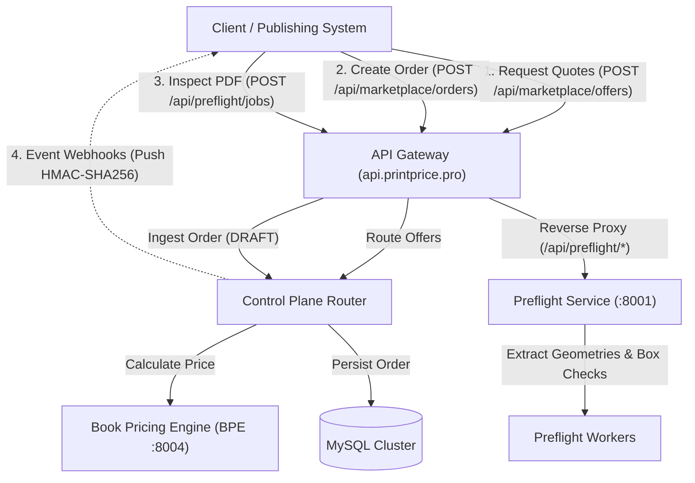

# PrintPrice OS Developer Platform — API Overview

The PrintPrice OS Developer Platform exposes structured HTTP APIs and event-driven contracts designed to connect external publishing systems, print houses, and e-commerce platforms with the central manufacturing intelligence layer.

:::info Contract Verification & Production Governance
This API documentation reflects the **audited implementation contracts** running in the PrintPrice OS ecosystem (`ppos-control-plane` and `ppos-preflight-service`).
- **Runtime Environment:** Core contracts are implemented, tested, and active. Partner endpoints require authorized credentials.
- **Production Safeguard:** Live interactive mutations (*Try-it-out*) against production endpoints (`https://api.printprice.pro`) are strictly gated to authenticated partners to prevent non-governed commercial transactions.
- **Partner Access:** Onboarding and API access are governed. Integrators can request access through [api-support@printprice.pro](mailto:api-support@printprice.pro).
:::

---

## Architecture & System Domains

To ensure clear operational boundaries, the PrintPrice OS ecosystem separates public developer surfaces across three distinct environments:

1. **Developer Portal & Onboarding (`https://printprice.pro/developers`):**  
   Commercial landing, integration overview, partner qualification, and contact channel for API access.
2. **Developer Documentation (`https://docs.printprice.pro`):**  
   Technical references, OpenAPI 3.1 specifications, payload schemas, and integration guides.
3. **API Perimeter & Control Plane (`https://api.printprice.pro`):**  
   The runtime execution layer where API gateways, Fastify routers, and Node.js microservices process requests.

---

## Published API Surfaces & Core Contracts

The following core contracts have been verified against active controller implementations:

| Domain | Method | Effective Path | Authentication | Responsible Service | Lifecycle Status |
| :--- | :---: | :--- | :--- | :--- | :---: |
| **Marketplace Offers** | `POST` | `/api/marketplace/offers` | Public Ingest (`x-trace-id`) or API Key | Control Plane (`ppos-control-plane`) | `VERIFIED_IN_CODE` |
| **Order Intake** | `POST` | `/api/marketplace/orders` | `X-Marketplace-Token` / Bearer JWT | Control Plane (`ppos-control-plane`) | `VERIFIED_IN_CODE` |
| **Order Details & Readiness** | `GET` | `/api/marketplace/orders/:orderId` | `X-Marketplace-Token` / Bearer JWT | Control Plane (`ppos-control-plane`) | `VERIFIED_IN_CODE` |
| **Offer Selection** | `POST` | `/api/marketplace/orders/:orderId/selected-offer` | `X-Marketplace-Token` / Bearer JWT | Control Plane (`ppos-control-plane`) | `VERIFIED_IN_CODE` |
| **File Metadata Registration** | `POST` | `/api/marketplace/orders/:orderId/files/register` | `X-Marketplace-Token` / Bearer JWT | Control Plane (`ppos-control-plane`) | `VERIFIED_IN_CODE` |
| **Preflight Job Binding** | `POST` | `/api/marketplace/orders/:orderId/files/:fileId/preflight-bind` | `X-Marketplace-Token` / Bearer JWT | Control Plane (`ppos-control-plane`) | `VERIFIED_IN_CODE` |
| **Readiness Recompute** | `POST` | `/api/marketplace/orders/:orderId/readiness/recompute` | `X-Marketplace-Token` / Bearer JWT | Control Plane (`ppos-control-plane`) | `VERIFIED_IN_CODE` |
| **Preflight Capabilities** | `GET` | `/api/preflight/capabilities` | Public Unauthenticated | Preflight Service (Proxy) | `VERIFIED_IN_CODE` |
| **Preflight Job Submission** | `POST` | `/api/preflight/jobs` | JWT / Scope `preflight:write` | Preflight Service (Proxy) | `VERIFIED_IN_CODE` |
| **Preflight Job Inspection** | `GET` | `/api/preflight/jobs/:id` | JWT / Scope `jobs:read` | Preflight Service (Proxy) | `VERIFIED_IN_CODE` |
| **Shared Preflight Report** | `GET` | `/api/public/preflight/human-report/:token` | Signed JWT (`HUMAN_REPORT_VIEW`) | Control Plane (`ppos-control-plane`) | `VERIFIED_IN_CODE` |
| **Customer Action Handoff** | `GET` | `/api/marketplace/orders/:orderId/customer-action/:token` | Ephemeral SHA-256 Token | Control Plane (`ppos-control-plane`) | `VERIFIED_IN_CODE` |
| **Outgoing Webhooks** | `POST` | Push to Partner HTTPS Endpoint | HMAC-SHA256 (`X-PPOS-Signature`) | Control Plane Outbox Worker | `VERIFIED_IN_CODE` |

:::note Surface Exclusions & Roadmapped Features
- **Administrative Routes:** All endpoints under `/api/admin/*`, `/api/printhouse/*`, `/api/federation/*`, and global order inspection (`GET /api/marketplace/orders`) are strictly administrative and excluded from public integration contracts.
- **Mockup 3D API:** The 3D Mockup generation capability is currently a roadmapped feature (`PLANNED`). No backend API endpoints exist at this time.
- **Developer Self-Service Credentials:** Programmatic self-service creation of API keys from a developer console is undergoing security gate review. Active partner credentials are provisioned manually by contacting [api-support@printprice.pro](mailto:api-support@printprice.pro).
:::

---

## OpenAPI 3.1 Modular Specifications

The official OpenAPI 3.1 specifications are partitioned by functional domain and available for download:

- **[Pricing & Marketplace Orders Specification](/openapi/pricing-marketplace.openapi.yaml)** — Quotes, order intake, file registration, and readiness.
- **[Preflight Inspection & Normalization Specification](/openapi/preflight.openapi.yaml)** — Capabilities catalog, multipart upload, inspection, and autofix.
- **[Customer Shared Diagnostic Reports Specification](/openapi/shared-reports.openapi.yaml)** — Human visual preflight summaries and file re-upload customer links.
- **[Consolidated Partner API Bundle](/openapi/printprice-partner-api.bundle.yaml)** — Consolidated bundle for Postman, Insomnia, and SDK generators.

---

## Integration Guidelines

1. **Deterministic Pricing:** Pricing outputs are calculated on-demand by the Book Pricing Engine based on physical book specifications (trim size, page count, paper stock, binding method).
2. **Strict Separation of Economic Concepts:** Direct manufacturing costs (`total_cost`), platform margins, and commercial suggested prices (`total_price`) are strictly decoupled in all responses.
3. **Fail-Safe Preflight Inspection:** PDF inspection extracts exact geometry boxes (TrimBox, BleedBox), embedded fonts, and image resolutions up to 2GB per file.
4. **Sanitized Client Views:** Shared diagnostic reports and customer remediation links automatically filter internal server paths and technical stack traces, presenting only actionable summaries.
