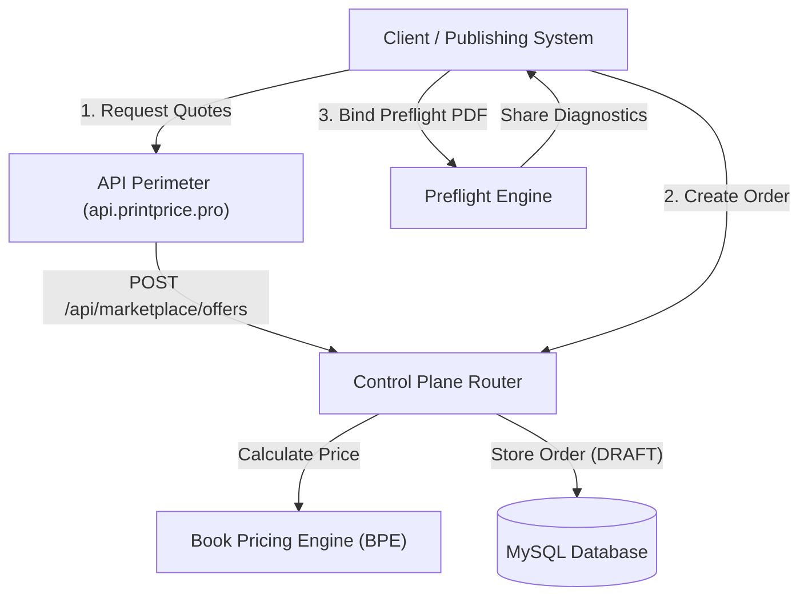

# PrintPrice OS Developer Platform — API Overview

The PrintPrice OS Developer Platform exposes structured HTTP APIs and contracts designed to connect external publishing systems, print houses, and e-commerce platforms with the central manufacturing intelligence layer.

:::warning DEV-02 Draft Specification & Governance Notice
This API documentation represents an **audited draft specification** derived directly from the PrintPrice OS Control Plane codebase (`ppos-control-plane`).
- **Current Runtime Status:** `DEV-01B_PARTIAL`. Read-only probes have been verified, but production availability, upstream proxy topology, and strict perimeter TLS certificates are subject to ongoing runtime validation.
- **Production Safeguard:** Live interactive testing (*Try-it-out*) against production endpoints (`https://api.printprice.pro`) is strictly disabled to prevent non-governed commercial transactions.
:::

---

## Architecture & System Domains

To ensure clear operational boundaries, the PrintPrice OS ecosystem separates public developer surfaces across three distinct environments:

1. **Developer Portal & Onboarding (`https://printprice.pro/developers`):**  
   Commercial landing, API access requests, partner qualification, and sandbox provisioning.
2. **Developer Documentation (`https://docs.printprice.pro`):**  
   Technical references, OpenAPI 3.1 draft specifications, payload schemas, and offline integration guides.
3. **API Perimeter & Control Plane (`https://api.printprice.pro` / `http://localhost:3000`):**  
   The runtime execution layer where API gateways, Fastify routers, and Node.js microservices process requests.

---

## Initial Core Contracts (Audited in DEV-02)

The following endpoints have been verified against active controller implementations in the Control Plane:

| Domain | Method | Effective Path | Authentication | Implementation Controller | Lifecycle Status |
| :--- | :---: | :--- | :--- | :--- | :---: |
| **Marketplace Offers** | `POST` | `/api/marketplace/offers` | Public Ingest (`x-trace-id`) | `src/api/routes/marketplacePublic.js:16` | `IMPLEMENTED_IN_CODE` |
| **Order Intake** | `POST` | `/api/marketplace/orders` | `X-Marketplace-Token` / Bearer JWT | `src/api/routes/marketplaceOrders.js:77` | `IMPLEMENTED_IN_CODE` |
| **Order Details & Readiness** | `GET` | `/api/marketplace/orders/:orderId` | `X-Marketplace-Token` / Bearer JWT | `src/api/routes/marketplaceOrders.js:184` | `IMPLEMENTED_IN_CODE` |
| **File Metadata Registration** | `POST` | `/api/marketplace/orders/:orderId/files/register` | `X-Marketplace-Token` / Bearer JWT | `src/api/routes/marketplaceOrders.js:271` | `IMPLEMENTED_IN_CODE` |
| **Preflight Job Binding** | `POST` | `/api/marketplace/orders/:orderId/files/:fileId/preflight-bind` | `X-Marketplace-Token` / Bearer JWT | `src/api/routes/marketplaceOrders.js:305` | `IMPLEMENTED_IN_CODE` |
| **Readiness Recompute** | `POST` | `/api/marketplace/orders/:orderId/readiness/recompute` | `X-Marketplace-Token` / Bearer JWT | `src/api/routes/marketplaceOrders.js:331` | `IMPLEMENTED_IN_CODE` |
| **Shared Preflight Report** | `GET` | `/api/public/preflight/human-report/:token` | Signed JWT (`HUMAN_REPORT_VIEW`) | `src/api/routes/publicPreflight.js:6` | `IMPLEMENTED_IN_CODE` |
| **Customer Action Handoff** | `GET` | `/api/marketplace/orders/:orderId/customer-action/:token` | Ephemeral SHA-256 Token | `src/api/routes/marketplacePublic.js:125` | `IMPLEMENTED_IN_CODE` |

---

## Integration Guidelines

- **Deterministic Pricing:** Pricing outputs are calculated on-demand by the Book Pricing Engine based on normalized book specifications (trim size, page count, paper type, binding).
- **Separation of Economic Concepts:** Manufacturing costs, transport/logistics, commercial markups, and final suggested prices are strictly decoupled in all responses.
- **Sanitized Client Views:** Shared diagnostic reports and customer remediation links automatically filter internal technical logs to present only customer-safe, actionable summaries.
