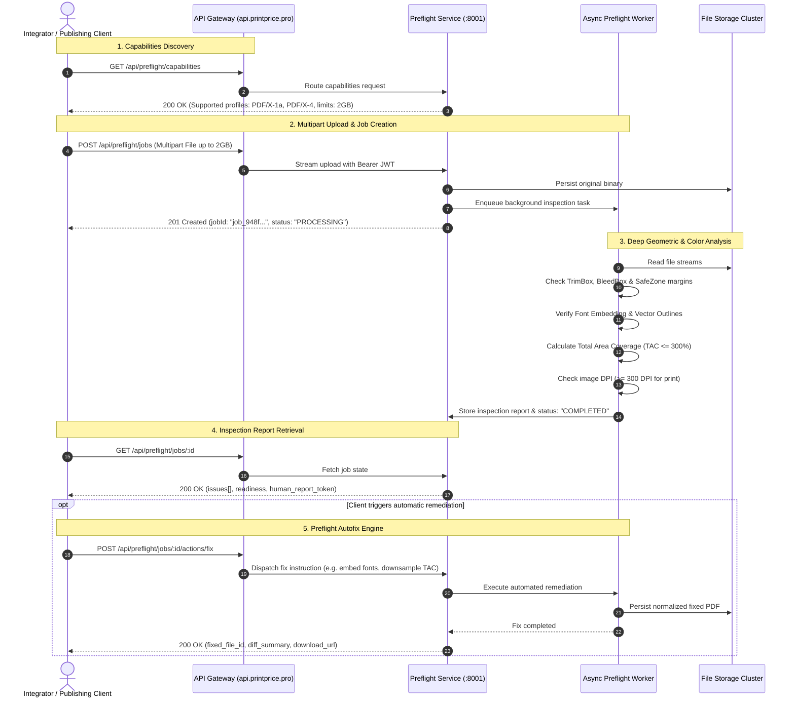

# Preflight & Shared Reports API

The Preflight API provides programmatic access to technical PDF inspection, production fact extraction, geometry box enforcement (TrimBox, BleedBox), automatic corrections, and sanitized customer-facing diagnostic reports.

:::note Architecture & Implementation Traceability
- **Core Inspection Engine:** Executed by `ppos-preflight-service` (listening on port 8001) and proxied through the Control Plane at `/api/preflight/*`.
- **Shared Diagnostic Link:** Implemented at [`src/api/routes/publicPreflight.js:6`](file:///c:/Users/KIKE/Downloads/ppos-control-plane-phase-10-intelligence-layer/src/api/routes/publicPreflight.js#L6) under `/api/public/preflight/human-report/:token`.
- **Customer Action Remediation:** Implemented at [`src/api/routes/marketplacePublic.js:125`](file:///c:/Users/KIKE/Downloads/ppos-control-plane-phase-10-intelligence-layer/src/api/routes/marketplacePublic.js#L125) under `/api/marketplace/orders/:orderId/customer-action/:token`.
:::



---

## 1. Capabilities Discovery (`GET /api/preflight/capabilities`)

Public endpoint returning active validation rules, supported trim geometry policies, and upload limits.

```bash
curl -X GET "https://api.printprice.pro/api/preflight/capabilities"
```

### Response (`200 OK`)
```json
{
  "supportedRules": [
    "GEOMETRY_TRIMBOX_VALIDATION",
    "BLEED_3MM_ENFORCEMENT",
    "IMAGE_RESOLUTION_300DPI",
    "COLOR_CMYK_ONLY",
    "FONTS_EMBEDDED_CHECK"
  ],
  "availableFixes": [
    "NORMALIZE_PAGE_BOXES",
    "GENERATE_SYNTHETIC_BLEED",
    "RGB_TO_FOGRA39_CONVERSION"
  ],
  "geometryPolicies": [
    "ISO_216_A_SERIES",
    "STANDARD_BOOK_SIZES"
  ],
  "maxUploadSizeBytes": 2147483648
}
```

---

## 2. Submit PDF for Inspection (`POST /api/preflight/jobs`)

Uploads a PDF file (up to 2GB) using `multipart/form-data` and triggers asynchronous worker analysis.

### Request (`curl`)
```bash
curl -X POST "https://api.printprice.pro/api/preflight/jobs" \
  -H "Authorization: Bearer YOUR_PARTNER_TOKEN" \
  -F "file=@/path/to/manuscrito_interior.pdf"
```

### Response (`200 OK`)
```json
{
  "ok": true,
  "jobId": "pf_job_8a7d6e5c-1234",
  "status": "QUEUED",
  "filename": "manuscrito_interior.pdf",
  "sizeBytes": 15420310
}
```

---

## 3. Retrieve Preflight Findings (`GET /api/preflight/jobs/:id`)

Queries the technical analysis report and generated artifacts for a job.

```bash
curl -X GET "https://api.printprice.pro/api/preflight/jobs/pf_job_8a7d6e5c-1234" \
  -H "Authorization: Bearer YOUR_PARTNER_TOKEN"
```

### Response (`200 OK`)
```json
{
  "ok": true,
  "job": {
    "id": "pf_job_8a7d6e5c-1234",
    "status": "COMPLETED",
    "outcome": "PASSED_WITH_WARNINGS",
    "filename": "manuscrito_interior.pdf",
    "report": {
      "pageCount": 192,
      "trimBox": { "widthMm": 148, "heightMm": 210 },
      "bleedBox": { "widthMm": 154, "heightMm": 216, "bleedMm": 3 },
      "colorProfile": "FOGRA39 (ISO 12647-2)",
      "lowestImageDpi": 240,
      "findings": [
        {
          "code": "IMAGE_DPI_SUBOPTIMAL",
          "severity": "warning",
          "page": 45,
          "message": "Imagen en página 45 cuenta con 240 DPI (mínimo recomendado: 300 DPI)."
        }
      ]
    },
    "artifacts": [
      { "id": "art_rep_01", "type": "report_json", "name": "report.json" },
      { "id": "art_norm_pdf", "type": "normalized_pdf", "name": "normalized.pdf" }
    ]
  }
}
```

---

## 4. Trigger Automatic Corrections (`POST /api/preflight/jobs/:id/actions/fix`)

Executes automated page box normalization, synthetic bleed generation, or color space conversion:

```bash
curl -X POST "https://api.printprice.pro/api/preflight/jobs/pf_job_8a7d6e5c-1234/actions/fix" \
  -H "Authorization: Bearer YOUR_PARTNER_TOKEN" \
  -H "Content-Type: application/json" \
  -d '{
    "autoFixOptions": {
      "normalizeBoxes": true,
      "generateBleed": true,
      "convertRgbToCmyk": true
    }
  }'
```

---

## 5. Download Inspection Artifacts (`GET /api/preflight/jobs/:id/artifacts/:artifactId`)

Streams the binary file (normalized PDF or structured JSON report):

```bash
curl -X GET "https://api.printprice.pro/api/preflight/jobs/pf_job_8a7d6e5c-1234/artifacts/art_norm_pdf" \
  -H "Authorization: Bearer YOUR_PARTNER_TOKEN" \
  --output normalized.pdf
```

---

## 6. Shared Preflight Human Report (`GET /api/public/preflight/human-report/:token`)

Allows print houses to share a customer-safe, visual diagnostic of an uploaded PDF without exposing internal server paths or operational logs.

### Authentication & Token Validation
- **Token Format:** Signed JWT in path parameter (`:token`).
- **Required Scope:** Must be signed with `HUMAN_REPORT_VIEW`.
- **Database Isolation:** Enforces multitenant boundary matching `tenant_id`, `job_id`, and `id`.

### Response (200 OK)
```json
{
  "ok": true,
  "job_id": "pf_job_8a7d6e5c-1234",
  "snapshot_id": "snap_998877",
  "tenant_id": "tenant_default",
  "report": {
    "outcome": "FIXED_REVIEW_REQUIRED",
    "summary": {
      "title": "Informe de Verificación de Archivos",
      "description": "Se detectaron advertencias que requieren confirmación visual.",
      "pages_analyzed": 192,
      "color_space": "CMYK (FOGRA39)"
    },
    "artifact_recommendations": [
      {
        "artifact_id": "art_visual_diff_01",
        "artifact_type": "VISUAL_DIFF_PAGE_12",
        "label": "Comparativa de corrección en página 12 (resolución de imagen)",
        "customer_visible": true,
        "download_url": "/api/public/preflight/artifacts/art_visual_diff_01?token=..."
      }
    ],
    "customer_actions": [
      {
        "action_id": "review_required",
        "label": "Revisión requerida antes de imprimir",
        "description": "El archivo corregido debe ser aprobado antes de enviar a planchas.",
        "severity": "warning"
      }
    ]
  }
}
```

:::note Error Handling: Missing Snapshots
In the current implementation (`publicPreflight.js:12`), missing snapshots (`SNAPSHOT_NOT_FOUND`) return **HTTP 400** because the service does not assign a custom `statusCode` before evaluating `result.statusCode || 400`. Returning **HTTP 404** represents a target contract proposal (`[PROPUESTA DEV-02]`).
:::

---

## 7. Customer Action Remediation Link (`GET /api/marketplace/orders/:orderId/customer-action/:token`)

When preflight detects blocking errors that require the client to supply new files, a time-limited customer remediation token is dispatched.

### Security & Lifecycle Details
1. **Hash Verification:** The server computes `SHA-256(token)` and matches it using string inequality `!==` against `tokenHash` in `marketplaceCustomerActionService.js:522`. Constant-time comparison (`crypto.timingSafeEqual`) is a recommended future hardening.
2. **Expiration Enforcement:** Validates `expiresAt`. Expired links return **`HTTP 410 Gone`**.
3. **Execution Sequence & State:** The endpoint returns `validation.action` as read from the database upon token validation. The initial state assigned upon action creation in `marketplaceCustomerActionService.js:165` is **`PENDING_NOTIFICATION`**. The controller executes `await customerActionService.markCustomerActionViewed(orderId, token)` before sending the HTTP response. This update is awaited, but wrapped within a non-fatal `try/catch` block so that database persistence failures do not block the customer from receiving the remediation instructions. Therefore, on the initial request, `status` is **`"PENDING_NOTIFICATION"`** (the state read at validation time). If the subsequent update in the database fails, `VIEWED` is not persisted and subsequent queries cannot guarantee `"VIEWED"`.

### Response (200 OK — Initial Request)
```json
{
  "success": true,
  "orderId": "ord_9b1deb4d-3b7d-4bad-9bdd-2b0d7b3dcb6d",
  "action": {
    "type": "FILE_REUPLOAD_REQUIRED",
    "status": "PENDING_NOTIFICATION",
    "requiredFiles": ["INTERIOR_PDF"],
    "blockers": ["LOW_IMAGE_DPI_PAGE_45"],
    "message": "Por favor, sustituya el PDF interior con imágenes a 300 DPI.",
    "expiresAt": "2026-11-01T23:59:59.000Z",
    "createdAt": "2026-10-25T14:00:00.000Z"
  },
  "currentFiles": [
    {
      "file_id": "fil_int_01",
      "role": "INTERIOR_PDF",
      "status": "REJECTED",
      "preflight_status": "FAILED",
      "preflight_outcome_category": "REJECTED_RESOLUTION",
      "findings_count": 3,
      "version": 1
    }
  ],
  "trace_id": "trace_99887766"
}
```

---

## 8. Contract Specifications

Download the formal OpenAPI 3.1 specifications for this domain:
- **[Preflight Inspection & Normalization Specification](/openapi/preflight.openapi.yaml)**
- **[Customer Shared Diagnostic Reports Specification](/openapi/shared-reports.openapi.yaml)**
