# Pricing & Offers API

The Pricing & Offers API provides programmatic access to deterministic cost calculations and competitive print house offers generated by the PrintPrice OS Book Pricing Engine (BPE).

:::note Implementation Traceability
This contract is implemented in the Control Plane at [`src/api/routes/marketplacePublic.js:16`](file:///c:/Users/KIKE/Downloads/ppos-control-plane-phase-10-intelligence-layer/src/api/routes/marketplacePublic.js#L16) and served under `/api/marketplace/offers`.
:::

```mermaid
flowchart TD
    subgraph InputStage ["1. INGESTION & VALIDATION"]
        Req["POST /api/marketplace/offers\nPayload: copies, interior_pages,\nformat, binding_method, postal_code"]
        Validate["Fastify Schema Validator\nHeader x-trace-id Verification"]
        Req --> Validate
    end

    subgraph CalculationEngine ["2. BOOK PRICING ENGINE (BPE :8004)"]
        direction TB
        BPE_Entry["BPE Controller"]
        Imposition["Imposition & Sheet Geometry\nSignature breakdown (8/16/32pp) & Bleed trims"]
        PressSelection["Press Profile Evaluation\nSpeed, setup waste, click cost & plate consumption"]
        Finishing["Finishing Operations\nFolding, gathering, sewing/PUR glue & 3-knife trim"]
        Packaging["Packaging & Logistics\nVolumetric weight & shipping zone SLA"]

        BPE_Entry --> Imposition
        Imposition --> PressSelection
        PressSelection --> Finishing
        Finishing --> Packaging
    end

    subgraph EconomicDecoupling ["3. ECONOMIC DECOUPLING"]
        direction TB
        DirectCost["Direct Manufacturing Cost\n(Paper + Press + Finishing + Logistics)"]
        Multiplier["Tenant Margin Multiplier\nPlatform Multipliers & SLA Rules"]
        FinalPrice["Commercial Suggested Price\n(Strict separation: total_cost vs total_price)"]

        DirectCost --> Multiplier
        Multiplier --> FinalPrice
    end

    subgraph OutputStage ["4. DETERMINISTIC RESPONSE"]
        EvidenceGen["Cryptographic Evidence Generator\nevidenceId & selectedVariantId"]
        Response["200 OK Response\nPayload: offers[], breakdown, currency,\nvalid_until, evidenceId"]
        EvidenceGen --> Response
    end

    Validate --> BPE_Entry
    Packaging --> DirectCost
    FinalPrice --> EvidenceGen

    classDef inputNode fill:#151820,stroke:#64748B,stroke-width:1.5px,color:#FFFFFF;
    classDef bpeNode fill:#1A1E29,stroke:#E53935,stroke-width:2px,color:#FFFFFF;
    classDef econNode fill:#151820,stroke:#FF5252,stroke-width:1.5px,color:#FFFFFF;
    classDef outNode fill:#151820,stroke:#B71C1C,stroke-width:2px,color:#FFFFFF;

    class Req,Validate inputNode;
    class BPE_Entry,Imposition,PressSelection,Finishing,Packaging bpeNode;
    class DirectCost,Multiplier,FinalPrice econNode;
    class EvidenceGen,Response outNode;
```



---

## 1. Request Offers (`POST /api/marketplace/offers`)

Evaluates the physical specifications of a book and returns ranked offers from eligible print facilities.

### HTTP Headers
| Header | Value | Description |
| :--- | :--- | :--- |
| `Content-Type` | `application/json` | Mandatory payload format. |
| `x-trace-id` | `string` *(optional)* | Unique trace ID for request correlation across services. |

### Request Body (JSON)
| Field | Type | Required | Description |
| :--- | :---: | :---: | :--- |
| `copies` | Integer / String | **Yes** | Quantity of copies to print. Current controller checks presence/truthiness (`!payload.copies`); strict `type: integer, minimum: 1` is a target proposal (`[PROPUESTA DEV-02]`). |
| `interior_pages` | Integer / String | **Yes** | Total interior page count. Current controller checks presence/truthiness (`!payload.interior_pages`); strict `type: integer, minimum: 1` is a target proposal (`[PROPUESTA DEV-02]`). |
| `format` | String | No | Standard format code (`"148x210"`, `"A5"`). Current BPE processes strings only. Object dimensions `{width, height, unit}` represent a separate contract proposal (`[PROPUESTA DEV-02]`). |
| `paper_inner` | String | No | Interior paper specification (e.g., `"offset_white_90"`). |
| `paper_cover` | String | No | Cover paper specification (e.g., `"couche_gloss_250"`). |
| `binding_method` | String | No | Binding method normalized by `pricingEngineClient.js:283` (`"perfect_bound"` → `"perfect bound"`, `"hard_cover"` → `"hardcover"`). |
| `finishing_options` | String | No | Surface finishings normalized by `pricingEngineClient.js:287` (`"matt_lam_scratch"`, `"gloss_lam"`, `"soft_touch_lam"`). |
| `colors_inner` | String | No | Interior color channels (e.g., `"1/1"`, `"4/4"`). |
| `colors_cover` | String | No | Cover color channels (e.g., `"4/0"`). |
| `delivery_country` | String | No | Destination ISO 3166-1 alpha-2 country code (e.g., `"ES"`). |

#### Example Request (`curl`)
```bash
curl -X POST "http://localhost:3000/api/marketplace/offers" \
  -H "Content-Type: application/json" \
  -H "x-trace-id: trace_demo_12345" \
  -d '{
    "copies": 500,
    "interior_pages": 192,
    "format": "148x210",
    "paper_inner": "offset_white_90",
    "paper_cover": "couche_gloss_250",
    "binding_method": "perfect_bound",
    "finishing_options": "matt_lam_scratch",
    "colors_inner": "1/1",
    "colors_cover": "4/0",
    "delivery_country": "ES"
#### Example Request (`Node.js fetch`)
```javascript
const response = await fetch("https://api.printprice.pro/api/marketplace/offers", {
  method: "POST",
  headers: {
    "Content-Type": "application/json",
    "x-trace-id": "trace_demo_12345"
  },
  body: JSON.stringify({
    copies: 500,
    interior_pages: 192,
    format: "148x210",
    paper_inner: "offset_white_90",
    paper_cover: "couche_gloss_250",
    binding_method: "perfect_bound",
    finishing_options: "matt_lam_scratch",
    colors_inner: "1/1",
    colors_cover: "4/0",
    delivery_country: "ES"
  })
});
const data = await response.json();
console.log(data);
```

---

## 2. Response Structure

### 200 OK — Successful Calculation
Returns a structured array of print offers sorted with recommended flags (note that `recommended_offer_id` and `raw_recommended_offer_id` can be `null` if no offer is recommended):

```json
{
  "success": true,
  "offers": [
    {
      "id": "off_01j7b9e84k2",
      "offer_id": "off_01j7b9e84k2",
      "house_id": "ph_valencia_01",
      "printer_id": "ph_valencia_01",
      "print_house_id": "ph_valencia_01",
      "print_house": "Talleres Gráficos Levante",
      "total_cost": 1240.50,
      "total_price": 1650.00,
      "currency": "EUR",
      "margin": 409.50,
      "margin_percent": 24.82,
      "estimated_delivery_time": "5-7 días laborables",
      "lead_time_days": 6,
      "breakdown": [
        { "label": "Papel interior", "amount": 420.00 },
        { "label": "Impresión y planchas", "amount": 380.50 },
        { "label": "Encuadernación rústica", "amount": 310.00 },
        { "label": "Embalaje y paletizado", "amount": 130.00 }
      ],
      "recommended": true,
      "checkout_allowed": true,
      "source": "BPE_MARKETPLACE_NATIVE"
    }
  ],
  "recommended_offer_id": "off_01j7b9e84k2",
  "raw_recommended_offer_id": "ph_valencia_01",
  "trace_id": "trace_demo_12345"
}
```

### 200 OK (Graceful Fallback) — Pricing Engine Unavailable
When the BPE is offline or fails to generate quotes, the API returns HTTP 200 with an explicit failure state:

```json
{
  "success": false,
  "offers": [],
  "message": "Pricing Engine unavailable.",
  "error_code": "BPE_UNAVAILABLE"
}
```

### 400 Bad Request — Missing Mandatory Fields
If `copies` or `interior_pages` is omitted:

```json
{
  "success": false,
  "message": "Missing required parameters: copies and interior_pages are mandatory.",
  "error_code": "INVALID_PAYLOAD"
}
```

---

## 3. Economic Separation

In accordance with PrintPrice OS financial governance:
- **`total_cost`:** The direct manufacturing expense computed from print house machine rates, setup time, and raw paper ODS matrix.
- **`total_price`:** The suggested commercial price including platform margin rules.
- **`breakdown`:** Transparent itemized cost lines ensuring complete explainability for publisher accounting.

---

## 4. Contract Specification

Download the formal OpenAPI 3.1 specification for this domain:
- **[Pricing & Marketplace Orders OpenAPI 3.1 Specification](/openapi/pricing-marketplace.openapi.yaml)**

