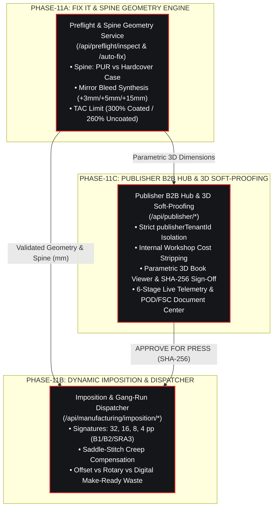

# Phase 11 — Editorial Manufacturing, Dynamic Imposition & 3D Soft-Proofing

This specification documents the end-to-end **Phase 11 Editorial Manufacturing Pipeline (`PHASE-11A`, `PHASE-11B`, and `PHASE-11C`)** running in the PrintPrice OS Control Plane (`ppos-control-plane`).



---

## 1. PHASE-11A: Automated Preflight & Spine Geometry Engine (`FIX IT Engine`)

Implemented in `src/api/services/preflight/preflightEngineService.js` and exposed at `/api/preflight/*`.

### 1.1 Theoretical Spine Calculation (`calculateTheoreticalSpine`)

* **Softcover PUR / Perfect Bound (`SOFTCOVER_PUR`):**
  ```text
  Spine_PUR (mm) = (Pages / 2) × (Grammage / 1000) × Bulk + Glue_Allowance (0.5 mm)
  ```
  * *Verified Benchmark:* `240 pages`, `90 g/m²`, `1.3 cm³/g` bulk → `120 × 0.09 × 1.3 + 0.5 = 14.54 mm`.
* **Hardcover Sewn Case (`HARDCOVER_SEWN`):**
  ```text
  Spine_Hardcover (mm) = Inner_Block + (2 × Board_Thickness) + Hinge_Allowance (1.5 mm)
  ```
  * *Verified Benchmark:* `320 pages`, `115 g/m²`, `1.15 cm³/g` bulk, `2.5 mm` greyboard → `21.16 + 5.0 + 1.5 = 27.66 mm`.
* **Tolerance Gate:** Triggers `SPINE_GEOMETRY_MISMATCH` (`CRITICAL`) whenever `|CalculatedSpine - DeclaredCoverSpine| > 1.0 mm`.

### 1.2 Bleed Geometry & Mirror Synthesis (`evaluateBleedGeometry`)
* **Inner Block:** Minimum `3.0 mm` bleed on head, foot, and face edges.
* **Softcover Cover:** Minimum `5.0 mm` bleed + recalibrated spine zone.
* **Hardcover Case Turn-In:** Minimum `15.0 mm` turn-in margin around greyboard edges.
* **Auto-Fix (`POST /api/preflight/auto-fix`):** Synthesizes missing bleed via edge-pixel mirror reflection (`MIRROR_BLEED_SYNTHESIS`) and recalibrates the cover spine width (`COVER_SPINE_TEMPLATE_RECALIBRATION`).

### 1.3 Colorimetric TAC & Resolution Rules
* **Total Area Coverage (`TAC`):** Maximum `300%` for Coated substrates (*ISO Coated v2 / FOGRA39*) and `260%` for Uncoated offset papers (*PSO Uncoated ISO12647*).
* **Pure Black Small Text:** Flags 4-channel rich black text below `12 pt` for automatic `100% K` overprint conversion.
* **Image Resolution:** Minimum `300 DPI` for continuous-tone images and `800 DPI` for 1-bit lineart.

---

## 2. PHASE-11B: Dynamic Imposition & Gang-Run Dispatcher Engine

Implemented in `src/api/services/manufacturing/impositionEngineService.js` and exposed at `/api/manufacturing/imposition/*`.

### 2.1 Editorial Signature Decomposition (`calculateSignaturesLayout`)
Decomposes total book pages into standard folding signatures (`32`, `16`, `8`, and `4` pages) fitted to the machine sheet format (`B1: 720×1020 mm`, `B2: 520×720 mm`, `SRA3: 320×450 mm`, `WEB_ROTARY`), reserving:
* `>= 6.0 mm` intermediate trim gutters,
* `10–12 mm` gripper edge,
* `6.0 mm` CMYK densitometric control bar, and
* folding/collation marks.

* *Verified Benchmark:* A `240-page` book (`150×230 mm`) on a `B1 (720×1020 mm)` sheetfed press decomposes into **`7×32pp + 1×16pp`** (`8` signatures, `64` CMYK 4/4 CTP plates).

### 2.2 Progressive Creep Compensation (`calculateCreepOffset`)
For saddle-stitched editions (`SADDLE_STITCH`), nested sheets push inner pages outward toward the face trim. The engine applies progressive inward shingling:
```text
Sheet_Thickness (mm) = 4 × (Grammage / 1000) × Bulk
Creep_Offset_n (mm)  = (Sheet_Index_n - 1) × Sheet_Thickness
```
* *Verified Benchmark:* `64-page` saddle-stitched catalog (`16` nested 4pp sheets, `90 g/m²`, `1.3 cm³/g` bulk) → `0.468 mm` per sheet, reaching **`+7.02 mm`** on the innermost sheet (#16).

### 2.3 Technical Make-Ready & Run Waste (`estimateMakeReadyWaste`)
* **Offset Sheetfed CMYK 4/4 (`B1` / `B2`):** `150` setup sheets per signature + `1.5%` run waste + `+50` sheets per post-press finishing pass.
* **Web Offset Rotary (`WEB_ROTARY`):** `450` linear meters per reel setup + `2.2%` run waste.
* **Digital Sheetfed (`SRA3`):** `10` calibration sheets per job + `0.5%` run waste (`0` CTP plates).

---

## 3. PHASE-11C: Publisher B2B Hub, 3D Soft-Proofing & Lifecycle Notifications

Implemented in `src/api/services/publisher/publisherHubService.js` and exposed at `/api/publisher/*`.

### 3.1 Multi-Tenant Security & Workshop Cost Redaction
* **Tenant Isolation:** Authenticated `PUBLISHER` users are strictly scoped to their `publisherTenantId`. Cross-tenant queries return `403 FORBIDDEN_CROSS_TENANT_ACCESS`.
* **Commercial Confidentiality (`sanitizeOrderForRole`):** All internal printhouse workshop metrics (`ctpPlateCostEur`, `ctpPlatesCount`, `makeReadyWasteSheets`, `makeReadyWasteCostEur`, `printhouseMarginPct`, `internalManufacturingCostEur`) are stripped before serialization. Publishers only see their agreed purchase price (`agreedPurchasePriceEur`), technical specifications, and delivery milestones.

### 3.2 Parametric 3D Soft-Proofing & Digital Sign-Off
* Models the physical book in 3D using exact `TrimWidth × TrimHeight × CalculatedSpine` dimensions, vertical spine typography, hardcover case overhang (`+3.0 mm` board square), and toggleable `TrimBox` vs `BleedBox (+3.0 mm)` overlays.
* **Telematic Approval (`POST /api/publisher/orders/:id/proof-decision`):** Records `"APPROVE FOR PRESS"` (`APPROVED_FOR_PRESS`) with a `SHA256` signature hash, timestamp, and `approvedByUserId`, automatically advancing the order to `PLATES_AND_IMPOSITION` and dispatching a transactional notification (`PROOF_SIGNED_AND_QUEUED`).

### 3.3 REST API Reference Summary (Phase 11)

| Endpoint | Method | Role / Auth | Description |
| :--- | :---: | :--- | :--- |
| `/api/preflight/inspect` | `POST` | Control Plane / Printhouse JWT | Executes PHASE-11A spine, bleed, TAC & DPI inspection |
| `/api/preflight/auto-fix` | `POST` | Control Plane / Printhouse JWT | Synthesizes mirror bleed (+3mm) & recalibrates cover spine |
| `/api/preflight/inspections` | `GET` | Control Plane / Printhouse / Publisher JWT | Lists tenant preflight inspection reports |
| `/api/preflight/inspections/:id` | `GET` | Control Plane / Printhouse / Publisher JWT | Retrieves a single technical preflight report |
| `/api/manufacturing/imposition/plan` | `POST` | Control Plane / Printhouse JWT | Computes PHASE-11B signature breakdown, creep & waste |
| `/api/manufacturing/imposition/dispatch-queue` | `POST` | Control Plane / Printhouse JWT | Routes planned signatures & CTP plates into press queue |
| `/api/manufacturing/imposition/queue` | `GET` | Control Plane / Printhouse JWT | Lists active signature runs in the Manufacturing Queue |
| `/api/publisher/orders` | `GET / POST` | `PUBLISHER` / `PRINTHOUSE_ADMIN` JWT | Lists or submits B2B editorial orders (workshop costs stripped) |
| `/api/publisher/orders/:id/telemetry` | `GET` | `PUBLISHER` / `PRINTHOUSE_ADMIN` JWT | Returns 6-stage live manufacturing timeline & SSCC-18 tracking |
| `/api/publisher/orders/:id/proof-decision` | `POST` | `PUBLISHER` / `PRINTHOUSE_ADMIN` JWT | Submits formal 3D Soft-Proof approval (`APPROVED` / `REJECTED`) |
| `/api/publisher/notifications` | `GET` | `PUBLISHER` / `PRINTHOUSE_ADMIN` JWT | Lists transactional lifecycle notifications for the publisher tenant |
