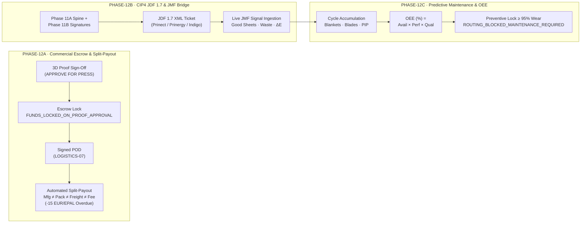

# Phase 12 — Commercial Escrow, CIP4 JDF 1.7 & Predictive OEE Engine

**Phase 12 (Roadmap 2026.5)** connects the physical book manufacturing pipeline from [Phase 11](/docs/architecture/editorial-manufacturing-phase11) with financial settlement governance, direct RIP/CTP hardware integration via **CIP4 JDF 1.7 / JMF**, and predictive press maintenance.



---

## 1. PHASE-12A: Commercial Escrow & Split-Payout Settlement Engine

Implemented in `src/api/services/financials/escrowSettlementService.js` and mounted at `/api/financials/escrow`.

### Core Invariant: Strict Cost Segregation
Every escrow record and settlement payout strictly isolates:

```text
Gross_Escrow_EUR = Manufacturing_Share_EUR + Packaging_Share_EUR + Freight_Share_EUR + Platform_Fee_EUR
```

### Escrow State Machine
1. `FUNDS_LOCKED_ON_PROOF_APPROVAL`: Triggered automatically when a publisher signs off on a 3D soft-proof (`APPROVE_FOR_PRESS` in Phase 11C).
2. `IN_MANUFACTURING_HOLD`: Funds remain locked in the commercial escrow ledger while CTP plates are burned and signatures are printed.
3. `RELEASED_ON_SIGNED_POD`: Triggered upon receiving a verified Proof of Delivery (`POD_RECEIVED`).
4. `DISPUTED_OR_PARTIAL_HOLD`: Activated when a delivery registers a quality claim deduction (`claimDeductionEur > 0`).

### Automated EPAL Euro-Pallet Deduction Rule
When settling on signed POD (`POST /api/financials/escrow/:orderId/settle-on-pod`), unreturned EPAL Euro-pallets beyond the 14-calendar-day exchange window are automatically penalized at **15.00 EUR per pallet**:

```text
EPAL_Deduction_EUR       = Unreturned_EPAL_Pallets * 15.00 EUR
Net_Carrier_Payout_EUR    = max(0, Freight_Share_EUR - EPAL_Deduction_EUR)
Net_Printhouse_Payout_EUR = max(0, Manufacturing_Share_EUR + Packaging_Share_EUR + EPAL_Deduction_EUR - Claim_Deduction_EUR)
```

---

## 2. PHASE-12B: CIP4 JDF 1.7 Job Ticket Generator & JMF Press Telemetry Bridge

Implemented in `src/api/services/manufacturing/jdfConnectorService.js` and exposed under `/api/manufacturing/imposition`.

### CIP4 JDF 1.7 XML Structure (`GET /api/manufacturing/imposition/:jobId/jdf-ticket.xml`)
Generates standards-compliant **CIP4 JDF 1.7 XML** job tickets compatible with **Heidelberg Prinect**, **Kodak Prinergy**, and **HP Indigo Production Pro** RIPs:
- `LayoutPreparationParams`: Embeds `NumberUp`, `FoldCatalog` (`32pp`, `16pp`, `8pp`, `4pp`), and `CreepCompensation` (`SheetThicknessMm`, `MaxInnerCreepMm`).
- `StrippingParams`: Defines machine sheet dimensions (`B1: 720×1020 mm`, `B2: 520×720 mm`, `SRA3: 320×450 mm`), gripper margin (`10–12 mm`), and densitometric color bar (`6 mm`).
- `ColorantControl`: Enforces `DeviceCMYK`, ICC profile (`ISOcoated_v2_300_eci.icc` or `PSO_Uncoated_ISO12647_eci.icc`), and maximum Total Area Coverage (`300%` coated / `260%` uncoated).
- `CoverApplicationParams`: Injects the exact physical spine width (`SpineWidthMm`) calculated in Phase 11A.
- `Component`: Declares target print run copies, calculated make-ready waste sheets (`MakeReadyWasteSheets`), and gross press sheets.

### JMF Telemetry Signal Ingestion (`POST /api/manufacturing/imposition/jmf/signal`)
Receives real-time **JMF (Job Messaging Format)** signals from press controllers, updating:
- `platesBurned`: CTP plates imaged and mounted.
- `goodSheetsCounter` & `wasteSheetsCounter`: Live net vs. setup waste sheet counters.
- `speedSheetsPerHour`: Instantaneous press speed (e.g. `16,500 sph`).
- `deltaEColorAccuracy`: Inline spectrophotometric color deviation (Delta-E 2000).

---

## 3. PHASE-12C: Predictive Machine Maintenance & Consumables Lifespan Engine

Implemented in `src/api/services/machines/predictiveMaintenanceService.js` and mounted at `/api/machines`.

### Nominal Consumable Lifespan Thresholds
| Consumable Code | Industrial Component | Nominal Lifespan (`maxLifespanCycles`) | Warning Threshold | Preventive Lock Threshold |
| :--- | :--- | :---: | :---: | :---: |
| `OFFSET_RUBBER_BLANKET` | Offset Rubber Blankets (Mantillas de caucho) | `1,200,000` impressions | `80.0%` | `95.0%` |
| `TRIMMER_BLADE` | 3-Knife Trimmer Blades (Cuchillas guillotina trilateral) | `150,000` cuts | `80.0%` | `95.0%` |
| `INKING_ROLLER` | Inking Rollers (Rodillos entintadores) | `5,000,000` impressions | `80.0%` | `95.0%` |
| `DIGITAL_PIP_FOIL` | Digital Imaging PIP / Blanket (HP Indigo) | `450,000` impressions | `80.0%` | `95.0%` |

### OEE Calculation & Preventive Routing Lock
1. **Overall Equipment Effectiveness (OEE)**:
   ```text
   OEE (%) = (Availability_Pct / 100) * (Performance_Pct / 100) * (Quality_Pct / 100) * 100
   ```
2. **Preventive Routing Interlock**: Whenever any consumable on a press or bindery unit reaches `>= 95.0%` wear without an active maintenance work order, the engine sets `routingBlocked = true` and transitions the machine to `ROUTING_BLOCKED_MAINTENANCE_REQUIRED`, preventing the Phase 11B dispatcher from assigning new jobs until `POST /api/machines/:machineId/maintenance-reset` is executed.

---

## 4. Verified Phase 12 API Endpoints

| Phase | Method | Endpoint | Purpose | Status |
| :--- | :---: | :--- | :--- | :--- |
| **12A** | `GET` | `/api/financials/escrow/ledger` | Returns tenant-scoped Escrow ledger entries and 4 summary KPIs. | <span className="status-badge status-badge-prod">CONFIRMED_IN_PRODUCTION</span> |
| **12A** | `POST` | `/api/financials/escrow/lock-on-approval` | Locks funds in commercial Escrow upon 3D soft-proof approval. | <span className="status-badge status-badge-prod">CONFIRMED_IN_PRODUCTION</span> |
| **12A** | `POST` | `/api/financials/escrow/:orderId/settle-on-pod` | Executes Split-Payout release on signed POD with EPAL deduction (`15 EUR/pallet`). | <span className="status-badge status-badge-prod">CONFIRMED_IN_PRODUCTION</span> |
| **12B** | `GET` | `/api/manufacturing/imposition/:jobId/jdf-ticket.xml` | Exports CIP4 JDF 1.7 XML job ticket (supports `?format=json` wrapper). | <span className="status-badge status-badge-prod">CONFIRMED_IN_PRODUCTION</span> |
| **12B** | `POST` | `/api/manufacturing/imposition/jmf/signal` | Ingests live JMF press telemetry signals (good sheets, waste, speed, Delta-E). | <span className="status-badge status-badge-prod">CONFIRMED_IN_PRODUCTION</span> |
| **12C** | `GET` | `/api/machines/predictive-maintenance` | Lists fleet OEE metrics, consumable wear bars, and routing lock state. | <span className="status-badge status-badge-prod">CONFIRMED_IN_PRODUCTION</span> |
| **12C** | `POST` | `/api/machines/:machineId/maintenance-reset` | Creates a maintenance work order, resets consumable wear to `0%`, and unblocks routing. | <span className="status-badge status-badge-prod">CONFIRMED_IN_PRODUCTION</span> |
