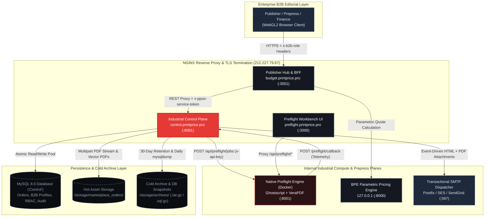
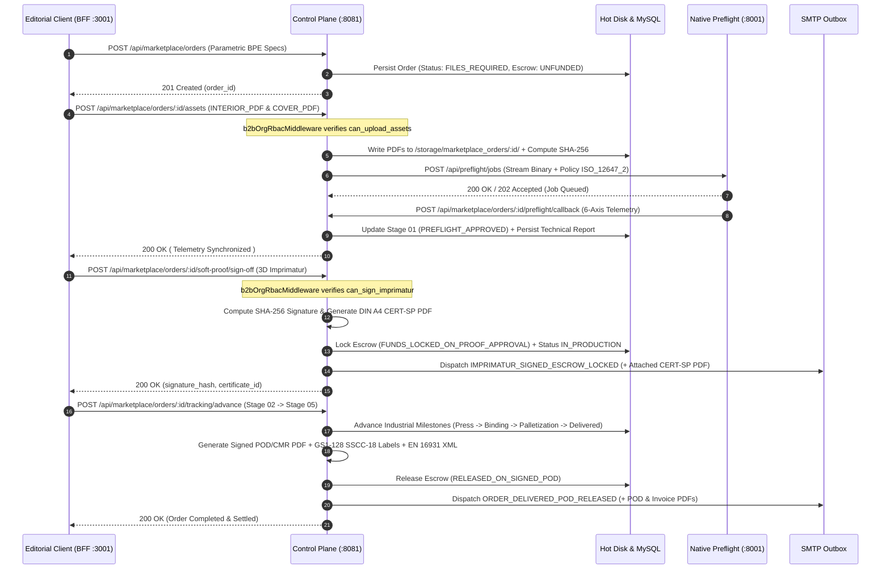

# System Architecture & Production Topology (Phases 10–16)

PrintPriceOS operates as a decoupled, deterministic multi-service industrial architecture designed for high-volume B2B book manufacturing, automated prepress validation, cryptographic soft-proofing, Merchant-of-Record (MoR) escrow governance, and EN 16931 regulatory compliance.

---

## 1. Decoupled Multi-Service Production Landscape

The production topology on `212.227.79.67` segregates public-facing editorial interaction, financial/order state machines, native PDF inspection, and parametric cost calculation into four isolated runtime planes:

| Service Plane | Public Domain / Internal Endpoint | Local Port | Process Manager / Runtime | Primary Responsibility |
| :--- | :--- | :--- | :--- | :--- |
| **Publisher Hub & BFF** | `https://budget.printprice.pro` | `:3001` | PM2 (`budget-app` — Node.js / Express + React 19 Vite) | Interactive B2B quoting, Parametric 3D Soft-Proofing UI, Dual Checkout, Customer & Printhouse Portals, and authenticated BFF proxy. |
| **Industrial Control Plane** | `https://control.printprice.pro` | `:8081` | PM2 (`ppos-control-plane` — Fastify + Express Router) | Order lifecycle state machine, MySQL persistence (`Control`), MoR Escrow ledger, EN 16931 XML generator, vector PDF engines, RBAC enforcement, SMTP notifications, and SRE storage lifecycle. |
| **Native Preflight Engine** | `https://preflight.printprice.pro` | `:8001` / `:3000` | Docker (`ppos-preflight-engine:2.1.0`) + PM2 (`preflight-app`) | Real binary PDF inspection via Ghostscript and VeraPDF, 6-axis ISO 12647-2 / PDF/X-4 validation, and asynchronous webhook telemetry callbacks. |
| **Book Pricing Engine (BPE)** | Internal Loopback (`127.0.0.1:8000`) | `:8000` / `:8004` | Docker / Python FastAPI (`bpe-service`) | Deterministic industrial calculation of sheet imposition, press signatures, paper bulk, binding mechanics, and landed freight matrices. |

### Network & Proxy Routing Topology

---

## 2. Fastify vs. Express Hybrid Routing in Control Plane (`:8081`)

The Control Plane (`ppos-control-plane`) runs a hybrid architecture combining Fastify edge performance with modular Express domain routers:

1. **Fastify Selective Upstream Proxy (`src/index.ts`):**
   - Upstream routes `/api/preflight/jobs*`, `/api/preflight/policies*`, and `/api/preflight/workers*` are proxied directly to the native Docker Preflight container (`http://127.0.0.1:8001`) with automatic `x-api-key` injection.
2. **Express Domain Routers (`src/api/app.js`):**
   - `/api/marketplace/orders/*`: Order intake, binary PDF upload (`multer`), 3D Soft-Proof cryptographic sign-off, MoR Escrow transitions, EN 16931 XML generation, and Stage 01–05 logistics tracking.
   - `/api/preflight/inspect`, `/api/marketplace/orders/:orderId/preflight/callback`, and `/api/marketplace/orders/:orderId/preflight/report`: Handled directly by [`preflightRoutes.js`](/docs/prepress/preflight-engine) to correlate native preflight findings with MySQL order state.
   - `/api/customer-portal/*`: B2B fiscal profiles, multi-user RBAC organization governance (`customer_b2b_members`), 1-Click Reorders, and invoice repositories.
   - `/api/telemetry/*` & `/api/storage/*`: Executive operational telemetry aggregation (`operationalTelemetryService.js`) and automated cold storage archiving / database snapshots (`assetRetentionAndBackupService.js`).

---

## 3. End-to-End Industrial Telemetry & Escrow Lifecycle

Every print order progresses through a strictly audited, deterministic lifecycle from parametric calculation to physical dock delivery and escrow payout release:

---

## 4. Production Resilience & Performance Benchmarks

Under full E2E stress verification on `212.227.79.67` (`365/365` requests succeeded, `0` HTTP `5xx` errors, `0` PM2 process restarts):

- **Vector PDF & EN 16931 Document Triad:** Generates native `PDF-1.4` documents (`CERT-SP`, `POD/CMR`, `GS1-128 SSCC-18`, and Commercial Invoices) without headless browser dependencies (zero Chromium/Puppeteer overhead), sustaining **`247.46 req/s`** with a median latency of **`169.67 ms`** at 50 concurrent connections.
- **Cryptographic Imprimatur & Escrow Locking:** Processes 50 simultaneous 3D Soft-Proof signatures in **`593 ms`** mean latency with transactional idempotency (`409 Conflict` protection against duplicate state mutations).
- **Concurrent Binary Asset Ingestion:** Streams 20 simultaneous multi-megabyte `INTERIOR_PDF` and `COVER_PDF` uploads with SHA-256 hashing and native preflight dispatch in **`489.50 ms`** median latency (`100%` I/O integrity).

---

## 5. Deep-Dive Documentation Modules

Explore the dedicated engineering specifications for Phases 10 through 16:

- **[Parametric 3D Soft-Proofing & Cryptographic Sign-Off](/docs/prepress/3d-soft-proof):** Spine bulk mathematics, TrimBox/BleedBox geometry, SHA-256 Imprimatur, and DIN A4 certificate generation.
- **[Native Preflight Engine & Bidirectional Telemetry](/docs/prepress/preflight-engine):** 6-axis PDF/X-4 validation, Ghostscript/VeraPDF telemetry contracts, and Stage 01 progression.
- **[B2B Multi-User Organization & RBAC Matrix](/docs/security/rbac-governance):** Normalized MySQL schema, 4 canonical B2B roles, middleware enforcement, and HTTP `403` error catalog.
- **[Regulatory Documents, EN 16931 E-Invoicing & Signed POD/CMR](/docs/compliance/electronic-invoicing-pod):** Facturae 3.2.2, XRechnung 3.0 (UBL 2.1), fiscal line segregation, and GS1-128 SSCC-18 logistics documentation.
- **[Storage Lifecycle, Cold Archiving & Database Snapshots](/docs/operations/storage-retention-backups):** POSIX `.tar.gz` cold archiving, SHA-256 freeze for 1-Click Reorders, daily `.sql.gz` snapshots, and executive telemetry.
- **[Complete REST API Reference & cURL Samples](/docs/api/reference):** Production request/response schemas and executable `curl` commands.

