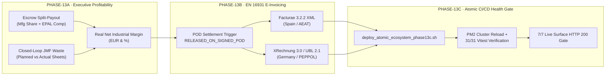

# Phase 13 — Real-Time Executive Profitability, EN 16931 E-Invoicing & Atomic CI/CD Gate

**Phase 13 (Roadmap 2026.6)** completes the financial and operational loop initiated in [Phase 11](/docs/architecture/editorial-manufacturing-phase11) and [Phase 12](/docs/architecture/financial-escrow-jdf-oee-phase12) by reconciling real press-room telemetry with net plant profitability, automating European electronic invoicing (`EN 16931`), and enforcing a zero-downtime deployment gate across the production ecosystem.



---

## 1. PHASE-13A: Real-Time Executive Profitability & Closed-Loop JMF Yield

Implemented in `src/api/services/financials/eInvoicingService.js` (`calculateExecutiveProfitabilitySummary`) and exposed via `GET /api/financials/escrow/profitability` and `src/ui/pages/production/ProductionDashboard.tsx`.

### Mathematical Reconciliation Formula
Traditional print MIS systems rely on static make-ready waste estimates. PrintPriceOS crosses the **Escrow Split-Payout** (`PHASE-12A`) with **live JMF press sheet counters** (`PHASE-12B`) and **Machine OEE** (`PHASE-12C`):

```text
Waste_Saved_Sheets          = Planned_MakeReady_Sheets - Actual_JMF_Waste_Sheets
JMF_Waste_Savings_EUR       = Waste_Saved_Sheets * Sheet_Substrate_And_Ink_Cost_EUR
Real_Direct_Mfg_Cost_EUR    = Estimated_Direct_Mfg_Cost_EUR - JMF_Waste_Savings_EUR
Net_Mfg_Revenue_EUR         = Manufacturing_Share_EUR + EPAL_Compensation_EUR - Claim_Deduction_EUR
Net_Industrial_Margin_EUR   = Net_Mfg_Revenue_EUR - Real_Direct_Mfg_Cost_EUR
Net_Industrial_Margin_Pct   = (Net_Industrial_Margin_EUR / Net_Mfg_Revenue_EUR) * 100
```

---

## 2. PHASE-13B: Automated EN 16931 Electronic Invoicing (`Facturae 3.2.2` & `XRechnung 3.0`)

Implemented in `src/api/services/financials/eInvoicingService.js` (`generateElectronicInvoiceXml`) and exposed via `GET /api/financials/escrow/:orderId/e-invoice.xml`.

### Supported European Standards
1. **`FACTURAE_3_2_2` (Spain)**: Generates XML compliant with `http://www.facturae.gob.es/formato/Versiones/Facturaev3_2_2.xml` (`SchemaVersion 3.2.2`).
2. **`XRECHNUNG_3_0` (Germany / DACH / EU PEPPOL)**: Generates OASIS UBL 2.1 `ubl:Invoice` XML compliant with `urn:cen.eu:en16931:2017#compliant#urn:xeinkauf.de:kosit:xrechnung_3.0`.

### Mandatory Line-Item Fiscal Segregation
Every electronic invoice preserves the PrintPriceOS invariant (`Manufacturing != Packaging != Freight`) through dedicated article codes:
- `MFG_EDITORIAL_PRINT`: Industrial book manufacturing for the specific ISBN and print run.
- `PACK_EPAL_FEFCO`: 3D palletization, FEFCO 0201 cartons, and GS1-128 SSCC-18 labeling.
- `FREIGHT_LANDED_DOCK`: Dedicated carrier road freight and distributor dock slot delivery.
- `EPAL_PALLET_COMPENSATION` *(conditional)*: Automatic `15.00 EUR/pallet` compensation line when EPAL Euro-pallets are not returned within 14 calendar days.

---

## 3. PHASE-13C: Atomic CI/CD Orchestration & Live Health Gate

Implemented in `scripts/deploy_atomic_ecosystem_phase13c.sh` on the production server (`212.227.79.67`).

### Zero-Downtime Deployment Sequence
1. **Control Plane Build & Sync**: Fetches `origin/main`, compiles the Vite production bundle (`dist/`), synchronizes static assets to `/var/www/vhosts/printprice.pro/control.printprice.pro/httpdocs/`, and restarts `ppos-control-plane` in PM2.
2. **Corporative Cluster Ownership & Reload**: Enforces `printprice.pro_a2w0fsu9yw9:psacln` ownership across `/var/www/vhosts/printprice.pro/current/.next` and executes a zero-downtime cluster reload (`pm2 reload printprice-web` across instances `18` and `19`) to prevent `BUILD_ID` chunk desynchronization.
3. **Automated HTTP 200 Gate & Remote Test Suite**: Verifies HTTP `200` across all public and documentation endpoints and runs the 31-test Vitest verification suite directly on the production host.

---

## 4. Verified Phase 13 API Endpoints

| Phase | Method | Endpoint | Purpose | Status |
| :--- | :---: | :--- | :--- | :--- |
| **13A** | `GET` | `/api/financials/escrow/profitability` | Returns tenant-scoped real-time net industrial margin EUR/%, JMF waste savings, and OEE per order. | <span className="status-badge status-badge-prod">CONFIRMED_IN_PRODUCTION</span> |
| **13B** | `GET` | `/api/financials/escrow/:orderId/e-invoice.xml` | Generates EN 16931 compliant `FACTURAE_3_2_2` or `XRECHNUNG_3_0` XML with segregated fiscal lines. | <span className="status-badge status-badge-prod">CONFIRMED_IN_PRODUCTION</span> |

