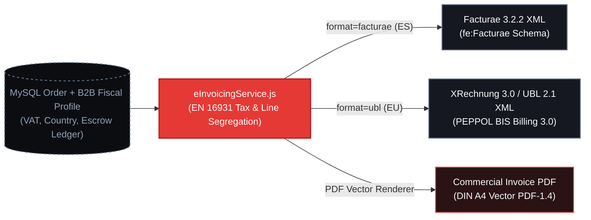

# Regulatory Documents, EN 16931 E-Invoicing & Signed POD/CMR

As a European B2B Merchant of Record (MoR) for industrial print manufacturing, PrintPriceOS automates the generation of legally compliant electronic invoices (**EN 16931**), international waybills (**Signed POD / CMR**), pallet barcoding (**GS1-128 SSCC-18**), and event-driven **SMTP Transactional Notifications**.

---

## 1. European Electronic Invoicing (`EN 16931`)

Implemented in `src/api/services/invoicing/eInvoicingService.js`, the e-invoicing engine supports the two primary European structured XML mandates alongside a vector DIN A4 Commercial Invoice PDF (`commercialInvoicePdfService.js`):

1. **Spain (`Facturae 3.2.2` XML):**
   - Compliant with Ley 25/2013 and Ley Crea y Crece (`fe:Facturae` namespace `http://www.facturae.gob.es/formato/Versiones/Facturaev3_2_2.xml`).
   - Supports Administrative Centres (`Oficina Contable`, `Órgano Gestor`, `Unidad Tramitadora`) for public/institutional publishing tenders and standard B2B NIF/CIF validation.
2. **Pan-European Cross-Border (`XRechnung 3.0` / `OASIS UBL 2.1` XML):**
   - Compliant with EU Directive 2014/55/EU and PEPPOL BIS Billing 3.0 (`urn:cen.eu:en16931:2017#compliant#urn:xeinkauf.de:kosit:xrechnung_3.0`).
   - Supports Intra-Community Reverse Charge (`AE` / `VATEX-EU-AE`) when buyer and seller reside in different EU Member States with valid VIES VAT numbers.

### 1.1 Strict Fiscal Line-Item Segregation (Inviolable Invariant)

In compliance with PrintPriceOS commercial governance rules, **Manufacturing**, **Packaging**, and **Landed Freight** are strictly segregated at both the database ledger and XML line-item levels (`InvoiceLine` / `cac:InvoiceLine`). Bundling freight into unit book manufacturing prices is strictly prohibited:

| Line Item Code | UNSPSC / CPV Classification | Description in XML & PDF | Tax Category |
| :--- | :--- | :--- | :--- |
| `MFG_EDITORIAL_PRINT` | `82121500` (Commercial Printing) | Industrial Book Manufacturing (Prepress, Plates, Paper Stock, Offset/Digital Press & Binding) | Standard or Super-Reduced Editorial VAT (`4%` ES Books / `21%` Commercial / `0%` Intra-EU Reverse Charge) |
| `PACK_EPAL_FEFCO` | `24112700` (Pallets & Packaging) | Industrial Export Packaging (FEFCO 0201 Double-Wall Boxes, Heat-Treated ISPM-15 EPAL Pallets & Stretch Wrap) | Standard VAT / Reverse Charge |
| `FREIGHT_LANDED_DOCK` | `78101800` (Road Freight Transport) | Dedicated Landed Freight & Tail-Lift Dock Delivery (Separated from Manufacturing) | Standard VAT / Reverse Charge |
| `EPAL_PALLET_COMPENSATION` | `24112701` (Pallet Pool Credit) | Circular Economy EPAL Pallet Exchange / Compensation Credit (if applicable) | Credit Line / Allowance |



---

## 2. Stage 05 Logistics: Signed POD/CMR & GS1-128 SSCC-18 Labels

Implemented in `src/api/services/logistics/podAndLabelsPdfService.js`, the logistics document engine generates two industrial vector PDF documents required for warehouse dispatch and escrow settlement:

### 2.1 GS1-128 SSCC-18 Pallet Labels (`DIN A6` — `105 x 148 mm`)

- **Endpoint:** `GET /api/marketplace/orders/:orderId/logistics/labels.pdf`
- **Format:** Native `PDF-1.4` DIN A6 (`297.64 x 419.53 pt`) vector pallet identification label.
- **Specifications:**
  - High-contrast vector barcode bars encoding Application Identifier `(00)` followed by the 18-digit **Serial Shipping Container Code (`SSCC-18`)** with Modulo-10 check digit validation.
  - Displays Shipper (Assigned Industrial Plant), Consignee (Publisher Warehouse Dock), Gross Pallet Weight (`kg`), Carton Count (`FEFCO 0201`), Units per Carton, and ISPM-15 heat-treatment certification mark.

### 2.2 Proof of Delivery & International CMR Waybill (`DIN A4`)

- **Endpoint:** `GET /api/marketplace/orders/:orderId/logistics/pod.pdf`
- **Format:** Native `PDF-1.4` DIN A4 (`595.28 x 841.89 pt`) vector delivery note and signed POD/CMR certificate.
- **Escrow Settlement Trigger (`STAGE_05_DELIVERED`):**
  - When the order advances to `Stage 05: Delivered & Signed POD`, the POD document embeds the consignee's **eIDAS electronic reception seal (`SHA-256`)**, GPS dock coordinates, reception timestamp, and receiver identity.
  - Simultaneously, the MoR Escrow ledger transitions from `FUNDS_LOCKED_ON_PROOF_APPROVAL` to **`RELEASED_ON_SIGNED_POD`**, authorizing net manufacturing payout to the printhouse.

---

## 3. Automated Transactional SMTP Notifications (`transactionalEmailService.js`)

Implemented in `src/api/services/notifications/transactionalEmailService.js`, the notification engine provides decoupled SMTP delivery (compatible with Postfix/Plesk on `212.227.79.67`, Amazon SES, Postmark, and SendGrid) with deterministic in-memory audit fallback (`simulated: true`) when running in isolated test environments.

### Canonical Transactional Templates & Binary PDF Attachments

| Template Code | Trigger Event | Default Recipient | Automatic Binary Attachment(s) |
| :--- | :--- | :--- | :--- |
- `ORDER_CREATED_WIRE_INSTRUCTIONS` | Checkout completed via `B2B_WIRE_TRANSFER` | Buyer (`FINANCE_APPROVER` / `ORG_ADMIN`) | `Proforma-Invoice-[orderId].pdf` (Contains IBAN, BIC/SWIFT, and mandatory payment reference) |
| `IMPRIMATUR_SIGNED_ESCROW_LOCKED` | 3D Soft-Proof signed (`POST /soft-proof/sign-off`) | Buyer + Assigned Printhouse | `CERT-SP-[orderId].pdf` (Cryptographic 3D Soft-Proof & Imprimatur Certificate) |
| `STAGE_04_DISPATCHED_LABELS_READY` | Order advances to `Stage 04: Palletized & Dispatched` | Buyer Logistics + Printhouse Dock | `SSCC-Labels-[orderId].pdf` (`GS1-128 SSCC-18` DIN A6 Pallet Labels) |
| `ORDER_DELIVERED_POD_RELEASED` | Order reaches `Stage 05: Delivered & Signed POD` | Buyer + Printhouse Finance | `POD-CMR-[orderId].pdf` + `Invoice-[orderId].pdf` (Signed POD & Final Commercial Invoice) |

---

## 4. API Reference: Regulatory Documents & Notifications

### 4.1 Download EN 16931 Electronic Invoice (`Facturae 3.2.2` or `UBL 2.1`)

- **RBAC Requirement:** `ORG_ADMIN` or `FINANCE_APPROVER` (`can_approve_finance: true`).

```bash
# Download Spanish Facturae 3.2.2 XML
curl -X GET "https://control.printprice.pro/api/marketplace/orders/ORD-2026-88412/einvoice.xml?format=facturae" \
  -H "x-b2b-role: FINANCE_APPROVER" \
  -o Facturae_ORD-2026-88412.xml

# Download Pan-European XRechnung 3.0 / UBL 2.1 XML
curl -X GET "https://control.printprice.pro/api/marketplace/orders/ORD-2026-88412/einvoice.xml?format=ubl" \
  -H "x-b2b-role: FINANCE_APPROVER" \
  -o XRechnung_UBL_ORD-2026-88412.xml
```

### 4.2 Download Vector Commercial Invoice, POD/CMR, and SSCC-18 Pallet Labels

```bash
# 1. Commercial Invoice PDF (DIN A4)
curl -sS "https://control.printprice.pro/api/marketplace/orders/ORD-2026-88412/invoice.pdf" -o Invoice.pdf

# 2. Signed Proof of Delivery / CMR Waybill PDF (DIN A4)
curl -sS "https://control.printprice.pro/api/marketplace/orders/ORD-2026-88412/logistics/pod.pdf" -o POD_CMR.pdf

# 3. GS1-128 SSCC-18 Pallet Labels PDF (DIN A6)
curl -sS "https://control.printprice.pro/api/marketplace/orders/ORD-2026-88412/logistics/labels.pdf" -o SSCC_Labels.pdf
```
