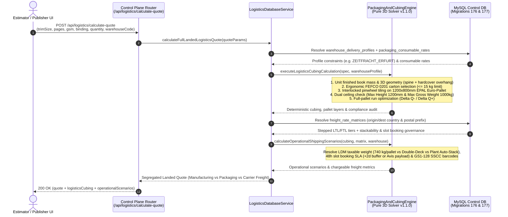
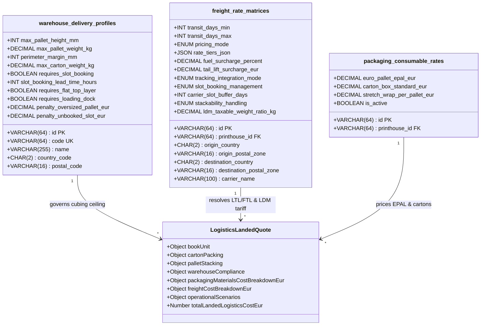
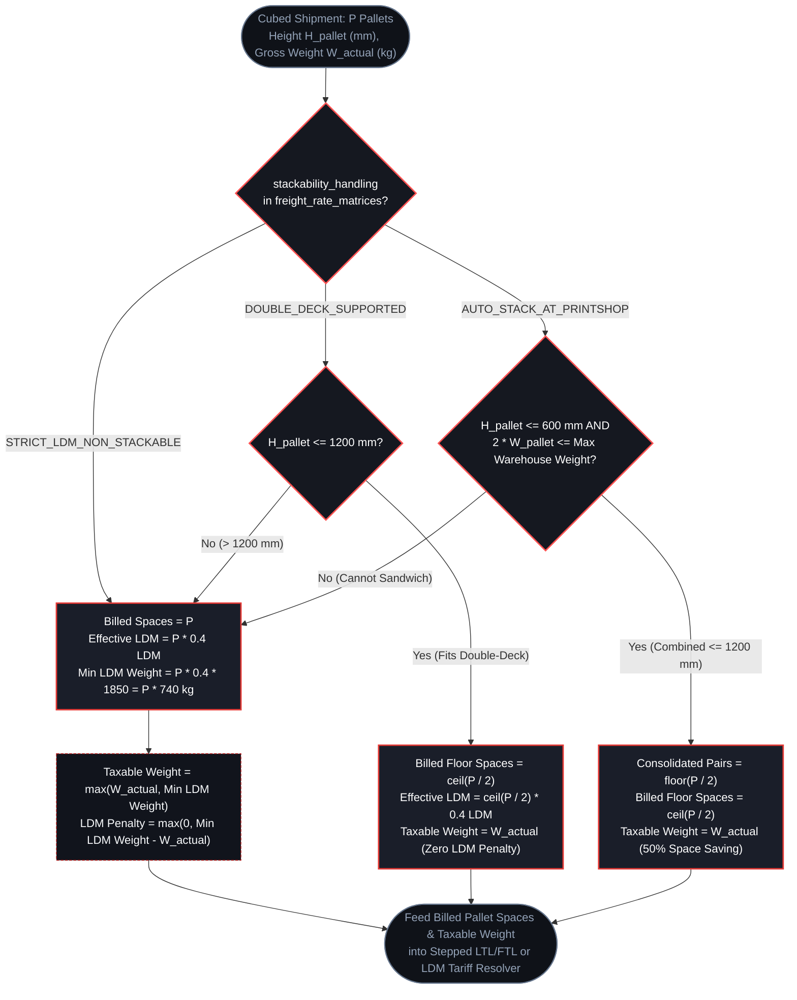

# 3D Cubing, Editorial Warehouses & Freight Engine

In industrial book manufacturing, **freight, palletization, and editorial warehouse compliance** frequently determine whether a production quote is profitable or eroded by logistics surcharges and receiving dock penalties. Unlike generic e-commerce parcel shipping, book distribution in the DACH and European markets (*Verlagsauslieferungen* such as **Zeitfracht Medien Erfurt** and **VVA Arvato Gütersloh**) operates under strict physical, ergonomic, and scheduling constraints.

The **3D Cubing, Editorial Warehouses & Freight Engine** (`packagingAndCubingEngine.js` and `logisticsDatabaseService.js`, introduced in Phases `LOGISTICS-01` through `LOGISTICS-04`, Migrations `176` & `177`) transforms raw book manufacturing specifications into deterministic 3D carton and Euro-pallet geometry, validates compliance against receiving hub rules, optimizes print runs to avoid half-empty pallets (`ΔQ-` / `ΔQ+`), and computes landed freight costs while maintaining **strict cost segregation**.

---

## 1. End-to-End Logistics & Cubing Sequence

When a quote preview or logistics calculation is requested, the Control Plane orchestrates five deterministic stages before resolving carrier freight tariffs and operational scenarios:



---

## 2. Deterministic 3D Cubing & Net Unit Mass

The pure calculation engine (`src/api/services/logistics/packagingAndCubingEngine.js`) operates with zero external I/O dependencies and reuses the canonical spine geometry solver (`spineCalculationEngine.js`) to guarantee mathematical parity between prepress imposition and physical palletization.

### Stage A: Trimmed Book Mass & Hardcover Geometry
Unlike press-sheet tonnage estimates that include trim waste and makeready spoilage, shipping weight is governed strictly by the **finished, guillotined book dimensions**:

1. **Trimmed Sheet Area (`A_sheet`)**:
   ```text
   A_sheet (m²) = (W_trim_mm × H_trim_mm) / 1,000,000
   ```
2. **Interior Paper Block Mass (`M_interior`)**:
   ```text
   M_interior (g) = (Pages / 2) × A_sheet × GSM_interior
   ```
3. **Softcover / Dust-Jacket Mass (`M_cover`)**:
   Accounts for front/back covers, spine wrap width, and optional French flaps (`coverFlapWidthMm`):
   ```text
   W_spread (mm) = (2 × W_trim_mm) + W_spine_mm + (2 × W_flap_mm)
   M_cover (g)   = ((W_spread × H_trim_mm) / 1,000,000) × GSM_cover
   ```
4. **Hardcover Case Binding Additions (*Deckenband / Casebound*)**:
   When `bindingType` is `hardcover`, the engine automatically adds:
   - **Greyboard Binder's Boards (*Graupappe*)**: Two rigid boards with `3 mm` square overhang (*Kantenüberstand*) on head, tail, and fore-edge, calculated at a physical density of **`1.20 g/cm³`** (e.g., `2.5 mm` board thickness = `3000 g/m²`).
   - **Endpapers (*Vorsatzpapier*)**: Two 4-page folded signatures (8 pages total, defaulting to `140 g/m²` offset stock).
   - **Adhesive, Crash Mull, Headbands & Case Cloth Allowance**: `+1.5%` mass factor (`+0.8%` for PUR/hotmelt perfect binding).

### Stage B: Ergonomic FEFCO 0201 Carton Packing
Books are grouped into standardized double-wall corrugated cardboard cartons (**FEFCO 0201**, `4 mm` B/C-flute wall thickness) selected from the industrial footprint catalog (`STANDARD_400x300`, `EURO_MODULAR_600x400`, `COMPACT_300x200`, `LARGE_BOOK_500x350`):

- **Ergonomic Weight Ceiling**: Enforces the warehouse's maximum carton weight (`maxCartonWeightKg`, strictly **`≤ 15.0 kg`** for Zeitfracht and Amazon FBA, **`≤ 16.0 kg`** for VVA Arvato) to prevent occupational health rejections and manual handling surcharges.
- **Internal Headspace & Snug Fit**: Reserves `6 mm` horizontal clearance for book insertion and caps internal stacking height at `280 mm` to prevent spine crushing.

### Stage C: Euro-Pallet EPAL (`1200 × 800 mm`) Interlocked Tiling & Dual Ceiling
Cartons are tiled onto standard **EUR-1 / EPAL wood pallets** (`1200 × 800 × 144 mm`, tare weight **`25.0 kg`**):

- **Perimeter Setback (*Retranqueo*)**: Subtracts `2 × minPerimeterSetbackMm` from the `1200 × 800 mm` deck before tiling cartons. Zero overhang (`maxOverhangMm: 0`) is permitted.
- **Interlocked Pinwheel Tiling (*Kreuzverband*)**: Evaluates orthogonal (`0°`), rotated (`90°`), and mixed pinwheel layer arrangements to maximize cartons per layer (`cartonsPerLayer`) and structural stability during road transit.
- **Dual Height & Weight Ceiling**: The maximum number of layers per pallet (`L_max`) is bounded simultaneously by the warehouse's total height limit (`H_max`, including the `144 mm` EPAL wood base) and maximum gross pallet weight (`W_max`, including the `25.0 kg` pallet tare):
  ```text
  L_max = min(
    floor((H_max_mm - 144) / H_carton_mm),
    floor((W_max_kg - 25.0) / (cartonsPerLayer × W_carton_kg))
  )
  ```

### Stage D: Full-Pallet Run Optimizer (`ΔQ-` / `ΔQ+`)
Whenever the requested print run leaves a partial remainder pallet with low utilization (`< 85%`), the engine computes two actionable commercial recommendations:
- **`ΔQ-` (`trimToExactFullPallets`)**: Reduces the print run to fill `P - 1` exact full pallets, eliminating the extra pallet base fee completely.
- **`ΔQ+` (`topUpLastPalletTo100Percent`)**: Increases the print run to fill all `P` pallets to `100%` capacity, amortizing the already-paid freight cost of the last pallet across additional copies and lowering unit landed cost (`landedLogisticsCostPerBookEur`).

---

## 3. Editorial Warehouse Compliance Profiles & Dock Rules

PrintPrice OS maintains four authoritative receiving profiles in `warehouse_delivery_profiles` (with built-in immutable fallbacks in `BUILTIN_WAREHOUSE_PROFILES`):

<div className="table-responsive-wrapper" tabIndex={0} role="region" aria-label="Editorial Warehouse Compliance Profiles">

| Profile Code | Hub / Operator | Max Pallet Height | Max Gross Weight | Max Carton Weight | Perimeter Setback | Special Receiving & Vehicle Requirements |
| :--- | :--- | :---: | :---: | :---: | :---: | :--- |
| `ZEITFRACHT_ERFURT` | **Zeitfracht Medien GmbH** (Erfurt, DE-99098) | **`1200 mm`** (incl. EPAL) | **`1000 kg`** | **`15.0 kg`** | **`30 mm`** (`3 cm`) | Ramp-compatible truck (**bed height `≥ 120 cm`, width `≥ 220 cm`**), mandatory **48h slot booking**, pallet content sheet & ISBN carton labels. |
| `ARVATO_VVA_GUETERSLOH` | **VVA — Arvato / Bertelsmann** (Gütersloh, DE-33334) | **`1300 mm`** (incl. EPAL) | **`700 kg`** | **`16.0 kg`** | **`20 mm`** (`2 cm`) | **Mandatory flat top layer** (`requiresFlatTopLayer: true`) for automated vacuum/conveyor depalletizers; 48h slot booking. |
| `AMAZON_EU_FBA_STD` | **Amazon EU FBA** (Bad Hersfeld, DE-36251) | **`1800 mm`** (incl. EPAL) | **`500 kg`** | **`15.0 kg`** | **`25 mm`** (`2.5 cm`) | 72h Carrier Central appointment, flat top layer, FNSKU/GS1-128 carton and 4-side pallet labels. |
| `STANDARD_COMMERCIAL_DOCK` | **Standard Commercial / Trade Printer Dock** | **`1650 mm`** (incl. EPAL) | **`950 kg`** | **`18.0 kg`** | **`15 mm`** (`1.5 cm`) | Standard commercial loading dock or tail-lift delivery (+€35 surcharge when tail-lift is required). |

</div>

### Non-Compliance Penalty Schedule (*Sonderaufwand / Gebührenkatalog*)

Delivering non-compliant pallets to German editorial hubs triggers automatic debit notes deducted from the publisher's or printer's settlement. The engine models and flags these exact penalty exposures:

| Violation Category | Trigger Condition | Penalty Tariff (EUR) | Operational Impact |
| :--- | :--- | :---: | :--- |
| **Unbooked Delivery Slot** (*Anlieferung ohne Zeitfenster*) | Arrival at Erfurt or Gütersloh dock without confirmed 48h/72h ramp time-slot | **€128.00 / shipment** | Immediate dock refusal or multi-hour demurrage wait + administrative fine. |
| **Oversized / Overhang Pallet** (*Umpacken / Überhöhe / Überstand*) | Pallet height `> 1200 mm` (Zeitfracht) / `> 1300 mm` (VVA) or carton overhang beyond setback | **€40.00 – €50.00 / pallet** | Manual repalletizing onto secondary EPAL pallets before high-bay storage intake. |
| **Non-Flat Top Layer** (*Unvollständige oberste Lage*) | Pyramid/stepped top layer delivered to automated VVA Arvato high-bay conveyor | **€35.00 / pallet** | Manual layer leveling required prior to automated induction. |
| **Non-Ramp-Compatible Vehicle** (*Keine Rampenhöhe / Sprinter*) | Delivery via van/Sprinter with loading bed `< 120 cm` height or `< 220 cm` width | **€150.00 – €185.00 / event** | Refusal at hydraulic dock levelers; requires external transshipment via local depot. |
| **Overweight Carton** (*Kartons `> 15 kg`*) | Individual carton gross weight exceeds `15.0 kg` (`16.0 kg` at VVA) | **€12.00 – €25.00 / carton** | Mandatory two-person lift handling or carton splitting surcharge. |

---

## 4. Relational Schema & Cost Segregation Model

In accordance with **PrintPrice OS Invariant #1 and #3**, manufacturing costs, packaging consumables, and carrier freight are persisted and reported in strictly segregated structures:

- **`manufacturingPrice`**: Pure printing, paper, binding, and finishing cost from the Book Pricing Engine (BPE).
- **`packagingMaterialsCostBreakdownEur`**: Certified EPAL Euro-pallets (€14.50/pallet default), double-wall FEFCO 0201 cartons (€0.85/carton default), and LLDPE stretch film + edge protectors (€2.20/pallet default).
- **`freightCostBreakdownEur`**: Base LTL/FTL carrier tariff + diesel surcharge % (`fuel_surcharge_percent`) + optional hydraulic tail-lift fee (`tail_lift_surcharge_eur`).



---

## 5. Operational Scenarios (Phase 198B — `LOGISTICS-04`)

### A. Stackability & Taxable Weight (*Frachtpflichtiges Gewicht / LDM*)

Because editorial hubs cap pallet height at `1.20 m` (`ZEITFRACHT_ERFURT`) or `1.30 m` (`ARVATO_VVA_GUETERSLOH`) inside trailers with `2.40 m – 2.70 m` internal clearance, carriers apply **Loading Meter (LDM)** taxation unless double-decking or printshop stacking is used. Each `1200 × 800 mm` Euro-pallet occupies **`0.4 LDM`** of trailer floor length.

The engine resolves three governed stackability modes (`stackability_handling`):

1. **`STRICT_LDM_NON_STACKABLE`**:
   - Pallets cannot be stacked in transit. The carrier bills the full vertical column above each pallet (`0.4 LDM` per pallet).
   - At the standard European road freight factor of **`1 LDM = 1850 kg`** (`ldm_taxable_weight_ratio_kg`), each non-stackable pallet has a minimum taxable weight of:
     ```text
     W_taxable_min = 0.4 LDM × 1850 kg/LDM = 740.0 kg per pallet
     ```
   - Even if a pallet physically weighs `480 kg`, the carrier bills it as `740 kg` (`ldmTaxableWeightPenaltyKg = 260 kg`).
2. **`DOUBLE_DECK_SUPPORTED` (*Doppelstock-LKW*)**:
   - The carrier operates trailers equipped with horizontal load-bearing crossbeams (*Doppelstockbalken*).
   - Two `1.20 m` pallets occupy a single `0.4 LDM` floor footprint without crushing lower cartons (`effectiveFloorPalletSpaces = ceil(totalPallets / 2)`), eliminating the non-stackable LDM penalty.
3. **`AUTO_STACK_AT_PRINTSHOP` (*Sandwich-Palettierung ab Druckerei*)**:
   - When individual pallets are half-height (**`≤ 600 mm`** each), the printshop stacks two pallets on top of each other with a rigid wooden separator deck so their combined height remains **`≤ 1200 mm`** (the Zeitfracht ceiling) and combined weight remains `≤ 1000 kg`.
   - Cuts billed carrier pallet spaces by up to `50%` while remaining `100%` compliant at the receiving dock.



### B. 48-Hour Slot Booking Governance (`CARRIER_MANAGED` vs. `SHIPPER_MANAGED`)

Both Zeitfracht Erfurt and VVA Arvato Gütersloh require mandatory time-slot reservations (`requires_slot_booking: true`, `slot_booking_lead_time_hours: 48`) prior to dock arrival, failing which a **€128.00 penalty** is levied:

- **`CARRIER_MANAGED` (*Avisierung durch Spedition*)**:
  - Major carriers (Dachser, DB Schenker, Raben) book the unloading ramp directly via CargoClix / Mercareon.
  - The engine automatically injects `carrier_slot_buffer_days` (**`+2 business days`** default) into the total estimated transit window (`effectiveTransitDaysMin` / `effectiveTransitDaysMax`) so publisher delivery dates remain realistic.
- **`SHIPPER_MANAGED` (*Avisierung durch Druckerei / Versender*)**:
  - For regional carriers or dedicated charters, the engine generates a structured `automatedDispatchNoticePayload` ready for dispatch to `avis-wareneingang-va@zeitfracht.de` (Erfurt) or `wareneingang-avis@arvato.com` (Gütersloh), containing pallet count, total gross weight, carton count, pallet height, and vehicle dock compliance attestation (`minLoadingBedHeightCm: 120`, `minLoadingBedWidthCm: 220`, `rearDockUnloadable: true`).

### C. Dual Tracking Protocol & GS1-128 SSCC / NVE Generation

To bridge integrated logistics networks with regional printshop fleets, `tracking_integration_mode` governs shipment visibility and pallet identification:

1. **`CARRIER_API` (REST / EDI / Webhooks)**:
   - Supports automated consignment creation and real-time webhook ingestion across four canonical milestone states:
     - `PICKED_UP_AT_PRINTSHOP` (*Recogido en imprenta*)
     - `IN_TRANSIT_HUB` (*En hub de tránsito*)
     - `OUT_FOR_DELIVERY_WITH_SLOT` (*En reparto con cita acordada*)
     - `DELIVERED_POD_SIGNED` (*Entregado con POD firmado*)
2. **`MANUAL_PORTAL_OR_CMR` (Regional Fleets & Charter Trucks)**:
   - When the carrier lacks a live API, the Control Plane **automatically generates a deterministic 18-digit GS1-128 SSCC / NVE (*Nummer der Versandeinheit*)** with Application Identifier `(00)` and a Modulo-10 check digit for every pallet in the shipment (e.g., `(00) 340123450000000105`).
   - Enables the printshop to print compliant **GS1-128 / VDA 4902 pallet labels** and the mandatory **Pallet Content Sheet (*Paletteninhaltsblatt*)** directly from the Control Plane, while capturing manual tracking URLs and signed CMR / delivery note (*Lieferschein*) PDFs.

---

## 6. Interactive 3D Isometric Pallet Preview (`PalletDiagramPreview.tsx`)

Within the Printhouse Setup and Shipping Configuration UI (`src/ui/components/printhouse/setup/ShippingPanel.tsx`), estimators can inspect the real-time 3D isometric CAD schematic of the palletized shipment (`PalletDiagramPreview.tsx`) in **English (`en`)** and **German (`de`)**:

- Renders the **`1200 × 800 mm` EPAL Euro-pallet** base, bottom protective greyboard, interlocked carton layers, corner edge protectors (*Kantenschutz*), top protective cardboard, plastic strapping bands, stretch foil, and pallet content label.
- Displays live compliance badges comparing actual stacked height against the selected warehouse ceiling (`≤ 1200 mm` Zeitfracht / `≤ 1300 mm` VVA Arvato) and highlights perimeter setback compliance (`30 mm` / `20 mm`).
