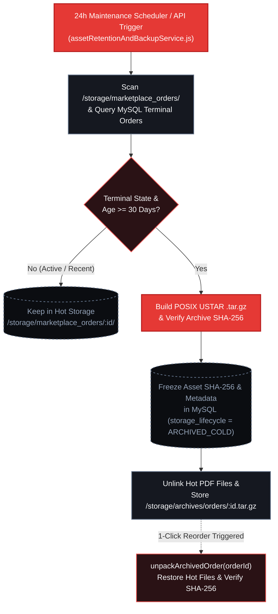

# Storage Lifecycle, Cold Archiving & Database Snapshots (SRE)

High-volume book manufacturing generates multi-gigabyte prepress binary streams (`INTERIOR_PDF` and `COVER_PDF`). To guarantee long-term disk stability on `212.227.79.67` without sacrificing **1-Click Exact Reorder** capabilities or cryptographic auditability, PrintPriceOS implements an automated **Storage Lifecycle & Database Snapshot Engine** (`assetRetentionAndBackupService.js`) paired with the **Executive Operational Telemetry Aggregator** (`operationalTelemetryService.js`).

---

## 1. Hot-to-Cold Storage Lifecycle (`POSIX USTAR .tar.gz`)

Implemented in `src/api/services/storage/assetRetentionAndBackupService.js`, the retention engine scans `/storage/marketplace_orders/` and cross-references `marketplace_orders` in MySQL:

### 1.1 Classification & Retention Policy

| Storage Tier | Order Lifecycle States | Age Threshold | Physical Location on Disk | Reorder Readiness |
| :--- | :--- | :--- | :--- | :--- |
| **Hot Storage** | `FILES_REQUIRED`, `PREFLIGHT_APPROVED`, `IN_PRODUCTION`, `SHIPPED` | Active orders (any age) + Terminal orders `< 30 days` | `/storage/marketplace_orders/:orderId/` (Uncompressed PDFs + JSON metadata) | Instant (`0 ms` extraction overhead) |
| **Cold Archive** | Terminal states: `DELIVERED`, `COMPLETED`, `CANCELLED` | `>= PPOS_RETENTION_COLD_DAYS` (Default: `30 days`) | `/storage/archives/orders/:orderId.tar.gz` (POSIX USTAR + Gzip Level 6) | On-demand restoration via `unpackArchivedOrder()` |

### 1.2 Cryptographic Metadata Freeze for 1-Click Reorders

Before removing the uncompressed hot directory `/storage/marketplace_orders/:orderId/`, the archiving pipeline performs three mandatory verification steps:

1. **POSIX USTAR Archive Packaging:** Packs all PDF binaries (`INTERIOR_PDF`, `COVER_PDF`, `WIRE_PROOF`) and telemetry manifests into a standard `.tar.gz` archive at `/storage/archives/orders/:orderId.tar.gz` and computes the archive's `SHA-256` checksum.
2. **Cryptographic Hash Freeze in MySQL:** Verifies that the original `SHA-256` digests (`interior_pdf_sha256`, `cover_pdf_sha256`), parametric geometry (`trim_width_mm`, `trim_height_mm`, `spine_width_mm`), and `storage_lifecycle` state (`ARCHIVED_COLD`) are permanently frozen in `marketplace_orders`.
3. **Zero-Downtime On-Demand Unpacking (`unpackArchivedOrder`):** When a publisher triggers a **1-Click Exact Reorder** (`POST /api/customer-portal/orders/:orderId/reorder`) on a cold-archived order, the Control Plane automatically unpacks `/storage/archives/orders/:orderId.tar.gz` back into the new order's hot workspace and verifies that extracted file `SHA-256` digests match the frozen MySQL hashes 1:1.



---

## 2. Automated MySQL Database Snapshots (`.sql.gz`)

To protect the transactional ledger (`marketplace_orders`, `customer_b2b_profiles`, `customer_b2b_members`, and audit trails), `assetRetentionAndBackupService.js` executes daily non-blocking database snapshots:

- **Execution Mechanics:** Invokes `mysqldump --single-transaction --quick --skip-lock-tables` (with automatic pure-Node.js SQL table serializer fallback if the `mysqldump` binary is restricted in containerized environments) piped directly through `zlib.createGzip()` into `/storage/archives/db_backups/ppos_control_YYYY-MM-DD_HHMMSS.sql.gz`.
- **Rotation Policy (`PPOS_DB_BACKUP_KEEP_COUNT`):** Retains the most recent **14 compressed snapshots** (`~14 days` of daily recovery points) and automatically prunes older `.sql.gz` files to bound disk consumption.
- **Scheduler (`initStorageMaintenanceScheduler`):** Runs automatically on a 24-hour interval inside `ppos-control-plane` without blocking the Fastify/Express event loop.

---

## 3. Real-Time Executive Operational Telemetry (`operationalTelemetryService.js`)

Implemented in `src/api/services/telemetry/operationalTelemetryService.js` and exposed via `GET /api/telemetry/executive-summary`, the observability engine aggregates five real-time vectors into a single low-latency JSON contract consumed by the Publisher Hub's **Executive SRE & Operations Console**:

1. **Industrial Production Funnel (`funnel`):** Atomic order counts across `Stage 01: Preflight`, `Stage 02: On Press`, `Stage 03: Binding`, `Stage 04: Palletization`, and `Stage 05: Delivered & Signed POD`.
2. **MoR Escrow & Financial Ledger (`escrow_finance`):** Total volume (`EUR`) segregated by `UNFUNDED`, `FUNDS_LOCKED_ON_PROOF_APPROVAL`, and `RELEASED_ON_SIGNED_POD`, plus accumulated platform MoR fees (`8.5%`).
3. **Prepress Quality & 6-Axis Compliance (`prepress_health`):** Pass rate (`%`), average effective DPI, average Max TAC (`%`), and top rejection causes.
4. **Storage Lifecycle & Backup Health (`storage_and_backups`):** Hot vs. Cold archive byte footprint, active disk savings, and latest `.sql.gz` MySQL snapshot verification.
5. **Runtime & Infrastructure Health (`infrastructure`):** MySQL connection pool latency (`ms`), Node.js RSS/Heap memory telemetry, and SMTP outbox delivery statistics.

---

## 4. SRE Operations API Reference

### 4.1 Inspect Storage Lifecycle & Backup Status

```bash
curl -X GET "https://control.printprice.pro/api/customer/storage/backup/status" \
  -H "x-marketplace-token: YOUR_MARKETPLACE_TOKEN" \
  -H "Accept: application/json"
```

#### Response (`200 OK`)

```json
{
  "ok": true,
  "retentionPolicy": {
    "coldRetentionDays": 30,
    "dbBackupKeepCount": 14,
    "schedulerIntervalHours": 24
  },
  "storageMetrics": {
    "hotOrdersCount": 59,
    "hotStorageBytes": 14829104,
    "coldArchivesCount": 4,
    "coldArchivesBytes": 412908
  }
}
```

### 4.2 Trigger On-Demand Retention Sweep or MySQL Snapshot

```bash
# Execute Hot-to-Cold Retention Sweep (Customer Portal or Admin SRE mirror)
curl -X POST "https://control.printprice.pro/api/customer/storage/retention/run" \
  -H "Content-Type: application/json" \
  -H "x-marketplace-token: YOUR_MARKETPLACE_TOKEN" \
  -d '{ "coldDays": 30, "dryRun": false }'

# Trigger Immediate Atomic MySQL Snapshot (.sql.gz)
curl -X POST "https://control.printprice.pro/api/customer/storage/backup/run" \
  -H "Content-Type: application/json" \
  -H "x-marketplace-token: YOUR_MARKETPLACE_TOKEN" \
  -d '{ "reason": "PRE_RELEASE_CHECKPOINT" }'
```

### 4.3 Query Real-Time Executive Operational Telemetry

```bash
curl -X GET "https://control.printprice.pro/api/customer/operations/summary" \
  -H "x-marketplace-token: YOUR_MARKETPLACE_TOKEN" \
  -H "Accept: application/json"
```

