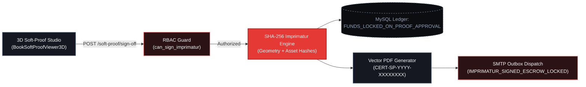

# Parametric 3D Soft-Proofing & Cryptographic Sign-Off (Phase-11C)

Phase-11C introduces an industrial WebGL2 / CSS-3D **Parametric 3D Soft-Proofing Studio** (`BookSoftProofViewer3D.tsx`) coupled with a legally binding **Cryptographic Imprimatur Engine** and a native **DIN A4 Vector PDF Certificate Generator** (`softProofCertificatePdfService.js`) in the Industrial Control Plane.

---

## 1. Parametric Geometric Engine & Spine Bulk Mathematics

Unlike generic static 3D mockups, the PrintPriceOS Soft-Proof Viewer dynamically computes physical book geometry from the exact paper stock, caliper/bulk factor, sheet imposition, and binding specification returned by the Book Pricing Engine (BPE).

### 1.1 Dynamic Spine Bulk Formula

The physical spine width `W_spine` (in millimeters) is computed deterministically before rendering the 3D mesh and validating the uploaded `COVER_PDF`:

```text
W_spine = (N_pages / 2) * ((G_paper * B_factor) / 1000) + Delta_binding
```

Where:
- `N_pages`: Total interior page count (must be an even multiple of press signatures, e.g., `240 pp`).
- `G_paper`: Interior paper basis weight in `g/m²` (e.g., `90 g/m²` offset or `80 g/m²` cream book paper).
- `B_factor`: Paper bulk factor (specific volume in `cm³/g`, e.g., `1.15` for standard uncoated offset, `1.75` for high-bulk novel paper, `0.90` for coated silk).
- `Delta_binding`: Mechanical binding allowance:
  - **PUR / EVA Perfect Binding (`PUR` / `EVA`):** `+0.6 mm` adhesive film and spine milling allowance.
  - **Casebound / Hardcover (`CASEBOUND` / `CARTONE`):** `+3.5 mm` board thickness and backing round allowance.

### 1.2 TrimBox, BleedBox, and Case Overhang Geometry

| Geometric Boundary | Specification | Tolerance / Offset | Industrial Purpose |
| :--- | :--- | :--- | :--- |
| **TrimBox (`finished_trim_mm`)** | Final guillotine cut dimensions (`W_trim x H_trim`) | `±0.5 mm` | Defines the finished book block size (e.g., `150 x 230 mm`) and visual fold lines in the 3D viewer. |
| **BleedBox (`bleed_margin_mm`)** | Exterior trim safety margin | `+3.0 mm` on top, bottom, and fore-edge | Prevents unprinted white paper slivers during hydraulic three-knife trimming. |
| **Hardcover Case Overhang (`ceja`)** | Rigid binder board projection beyond text block | `+3.0 mm` (head, tail, fore-edge) + `8.0 mm` French groove (`canal`) | Protects the sewn book block and accommodates the hinge crease on casebound titles. |
| **Barcode & Safety Zone** | Inner safety inset from TrimBox | `-5.0 mm` minimum inset | Ensures ISBN-13 / EAN-13 barcodes, colophons, and running heads are never clipped. |

---

## 2. Cryptographic Imprimatur (SHA-256 Digital Signature)

When an authorized B2B actor (`ORG_ADMIN` or `PRODUCTION_MANAGER` with `can_sign_imprimatur = true`) approves the 3D Soft-Proof, the Control Plane constructs a canonical, tamper-evident cryptographic signature (`SHA-256`) binding the exact binary files and physical geometry to the actor's identity.

### 2.1 Canonical Signature Formulation

The Control Plane computes `signature_hash` over a deterministic pipe-delimited canonical string:

```text
IMPRIMATUR_PAYLOAD = [
  order_id,                    // e.g. "ORD-2026-88412"
  interior_pdf_sha256,         // 64-char hex digest of uploaded INTERIOR_PDF
  cover_pdf_sha256,            // 64-char hex digest of uploaded COVER_PDF
  trim_width_mm,               // e.g. "150"
  trim_height_mm,              // e.g. "230"
  computed_spine_mm,           // e.g. "14.20"
  binding_type,                // e.g. "PUR_PERFECT_BOUND"
  approved_by_email,           // e.g. "carlos.mendoza@editorial-planeta.es"
  approved_at_iso8601,         // e.g. "2026-11-01T18:30:12.405Z"
  client_ip_address            // e.g. "212.227.79.67"
].join("|")

signature_hash = HMAC_OR_SHA256_HEX(IMPRIMATUR_PAYLOAD)
```

### 2.2 Legal Binding & Automatic Escrow Lock

Executing `POST /api/customer/orders/:orderId/soft-proof/approve` (or its Publisher Hub alias `POST /api/publisher/proofs/:orderId/sign-off`) triggers an atomic state transition across four subsystems:

1. **Order Production Lock:** Order status transitions from `PREFLIGHT_APPROVED` / `READY_FOR_PROOF` to `IN_PRODUCTION`. Binary assets (`INTERIOR_PDF` and `COVER_PDF`) become immutable on disk.
2. **MoR Escrow Lock:** The financial ledger transitions to `FUNDS_LOCKED_ON_PROOF_APPROVAL`, guaranteeing to the assigned industrial printhouse that 100% of the manufacturing and landed freight funds are held in custody by PrintPriceOS.
3. **Industrial Funnel Advancement:** The order advances from `Stage 01: Preflight Approved` into `Stage 02: On Press (Plates & Imposition)`.
4. **Automated Transactional Notification:** [`transactionalEmailService.js`](/docs/compliance/electronic-invoicing-pod) immediately dispatches the `IMPRIMATUR_SIGNED_ESCROW_LOCKED` email with the signed DIN A4 `CERT-SP` PDF attached.



---

## 3. Vector PDF Certificate Specification (`CERT-SP-YYYY-XXXXXXXX`)

The service `src/api/services/documents/softProofCertificatePdfService.js` generates a standalone, print-ready **DIN A4 Vector PDF (`595.28 x 841.89 pt`, `PDF-1.4`)** with zero external headless browser dependencies (average payload size `~10.7 KB`, generated in `< 5 ms`).

### Document Structure & Cryptographic Audit Blocks

1. **Industrial Header Banner (`#0F172A` Slate + `#DC2626` Red Accent):**
   - Document identifier `CERT-SP-YYYY-XXXXXXXX` (derived deterministically from the order ID and timestamp).
   - Official title: `CRYPTOGRAPHIC 3D SOFT-PROOF & IMPRIMATUR CERTIFICATE`.
   - Compliance badge: `ISO 12647-2 / PDF/X-4 VERIFIED • eIDAS ART. 25 ELECTRONIC SEAL`.
2. **Section 01 — Order & Editorial Organization Metadata:**
   - Order ID, B2B Organization Legal Name, VAT/NIF Identifier, Production Plant Assignment, and Imprimatur Timestamp (`UTC`).
3. **Section 02 — Validated Parametric Geometry & Prepress Telemetry:**
   - TrimBox dimensions (`W x H mm`), BleedBox (`+3.0 mm`), Computed Spine Width (`mm`), Interior Page Count, Paper Stock & Basis Weight (`g/m²`), Binding Method, Color Profile (`CMYK FOGRA39`), Effective Resolution (`>= 300 DPI`), and Max TAC (`<= 300%`).
4. **Section 03 — Binary Asset Fingerprints & Cryptographic Signature Seal:**
   - Full 64-character `SHA-256` digests of `INTERIOR_PDF` and `COVER_PDF`.
   - Full 64-character `SHA-256` Imprimatur Signature Seal (`signature_hash`).
   - Signatory Actor Name, Role (`ORG_ADMIN` / `PRODUCTION_MANAGER`), Email, and Client IP Address.
5. **Section 04 — Legal & MoR Escrow Binding Declaration:**
   - Certifies that editorial tolerances have been accepted and escrow funds are locked under `FUNDS_LOCKED_ON_PROOF_APPROVAL`.

---

## 4. API Contract: 3D Soft-Proof Sign-Off & Certificate Retrieval

### 4.1 Execute Cryptographic Sign-Off

- **Endpoint:** `POST /api/customer/orders/:orderId/soft-proof/approve` (Alias: `POST /api/publisher/proofs/:orderId/sign-off`)
- **RBAC Requirement:** `ORG_ADMIN` or `PRODUCTION_MANAGER` (`canApproveSoftProof: true`). Roles such as `PREPRESS_DESIGNER` or `FINANCE_APPROVER` receive `HTTP 403 FORBIDDEN_RBAC_INSUFFICIENT_SIGN_OFF_RIGHTS`.

```bash
curl -X POST "https://control.printprice.pro/api/customer/orders/ORD_2026_101/soft-proof/approve" \
  -H "Content-Type: application/json" \
  -H "x-marketplace-token: YOUR_MARKETPLACE_TOKEN" \
  -H "x-b2b-role: PRODUCTION_MANAGER" \
  -H "x-b2b-member-id: MEM_2026_0002" \
  -d '{
    "approvedBy": "production@printprice.pro",
    "comments": "Spine 27.66 mm and +3.0 mm BleedBox verified for CTP platesetter.",
    "geometry": {
      "trimWidthMm": 210,
      "trimHeightMm": 280,
      "spineThicknessMm": 27.66,
      "bleedMarginMm": 3.0
    }
  }'
```

#### Response (`200 OK`)

```json
{
  "ok": true,
  "orderId": "ORD_2026_101",
  "decision": "APPROVED",
  "proofStatus": "APPROVED_FOR_PRESS",
  "proofSignatureHash": "SHA256:9f86d081884c7d659a2feaa0c55ad015a3bf4f1b2b0b822cd15d6c15b0f00a08",
  "proofApprovedAt": "2026-11-01T18:42:10.114Z",
  "proofApprovedBy": "production@printprice.pro",
  "orderStatus": "IN_PRODUCTION",
  "escrowStatus": "FUNDS_LOCKED_ON_PROOF_APPROVAL"
}
```

### 4.2 Download Vector PDF Certificate (`CERT-SP`)

```bash
curl -X GET "https://control.printprice.pro/api/customer/orders/ORD_2026_101/soft-proof/certificate.pdf" \
  -H "x-marketplace-token: YOUR_MARKETPLACE_TOKEN" \
  -o CERT-SP-2026-ORD_2026_101.pdf
```

- **Response Headers:**
  - `Content-Type: application/pdf`
  - `Content-Disposition: inline; filename="CERT-SP-2026-88412.pdf"`
  - `X-PPOS-Document-Type: SOFT_PROOF_IMPRIMATUR_CERTIFICATE`
