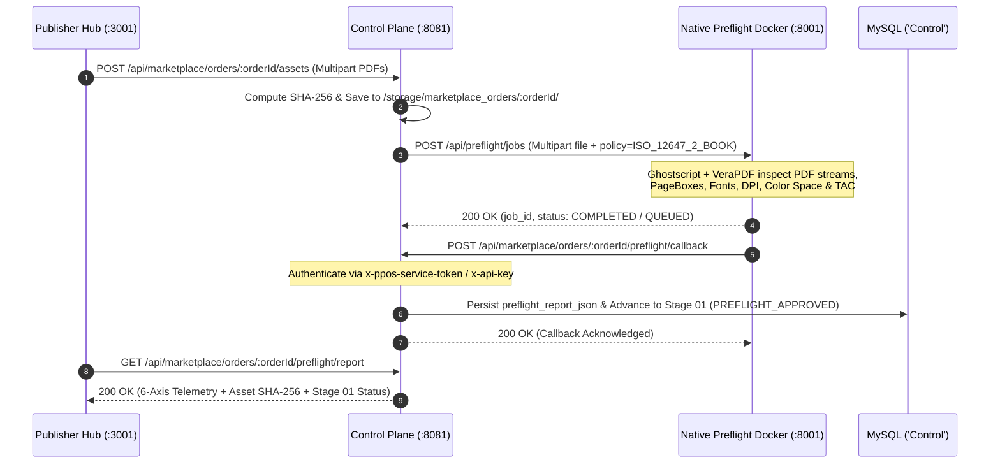

# Native Preflight Engine & Bidirectional Telemetry

PrintPriceOS enforces deterministic pre-press quality control before any job reaches press imposition or 3D Soft-Proofing sign-off. The **Native Preflight Engine** (`preflight.printprice.pro`, running inside Docker on `:8001` with a dedicated workbench UI on `:3000`) inspects physical PDF binaries using **Ghostscript** and **VeraPDF** and exchanges bidirectional telemetry with the **Industrial Control Plane** (`control.printprice.pro` `:8081`).

---

## 1. Six-Axis Industrial Prepress Validation Matrix

Every uploaded `INTERIOR_PDF` and `COVER_PDF` is evaluated against six mandatory **ISO 12647-2** and **PDF/X-4 (ISO 15930-7)** technical axes:

| Axis # | Technical Dimension | Target Standard / Threshold | Warning Condition | Blocking Error Condition |
| :--- | :--- | :--- | :--- | :--- |
| **Axis 01** | **Color Space & ICC Profile** | `CMYK` (`FOGRA39` / `PSO Coated v3` or `FOGRA47` Uncoated) | Embedded `sRGB` objects auto-convertible via GCR (`DeviceRGB_Warning`) | Uncalibrated `Lab`, `ICCBased` without fallback, or unmapped spot Pantone channels on a 4/4 CMYK job |
| **Axis 02** | **Effective Image Resolution** | `>= 300 DPI` for continuous-tone images; `>= 1200 DPI` for 1-bit line art | `200 DPI <= res < 300 DPI` (flagged with page numbers) | Effective resolution `< 150 DPI` on cover or key interior plates |
| **Axis 03** | **Total Area Coverage (Max TAC)** | `<= 300%` (Coated stock) / `<= 260%` (Uncoated offset stock) | `300% < TAC <= 320%` (GCR/UCR ink optimization recommended) | `TAC > 320%` (risk of set-off, sheet sticking, and drying failure on web/sheetfed offset) |
| **Axis 04** | **Font Embedding & Glyph Subsets** | `100%` embedded (`/FontFile`, `/FontFile2`, or `/FontFile3` streams) | OpenType CFF subset without full character map | Any unembedded font (`embedded: false`) causing glyph substitution on RIP |
| **Axis 05** | **TrimBox vs. BleedBox Geometry** | Exact TrimBox match (`±0.5 mm`) + `>= 3.0 mm` exterior BleedBox | Bleed margin between `2.0 mm` and `2.9 mm` | Missing `/TrimBox`, missing `/BleedBox`, or dimensions mismatching the BPE order specification |
| **Axis 06** | **Parametric Spine Bulk Match** | `COVER_PDF` total spread width matches `2 * W_trim + W_spine + 2 * W_bleed` | Spine delta between `0.5 mm` and `1.0 mm` | Spine delta `> 1.0 mm` relative to computed paper bulk formula |

---

## 2. Bidirectional Routing Architecture (`:8081` ↔ `:8001`)

To prevent routing collisions between direct browser API calls and internal Control Plane orchestration, `ppos-control-plane` (`:8081`) splits `/api/preflight/*` traffic cleanly:

1. **Fastify Upstream Proxy (`src/index.ts`):**
   - Forwards `/api/preflight/jobs*`, `/api/preflight/policies*`, and `/api/preflight/workers*` directly to the native Docker Preflight Engine (`http://127.0.0.1:8001`), injecting the `x-api-key` service credential.
2. **Express Telemetry & Persistence Router (`src/api/routes/preflightRoutes.js`):**
   - Handles `/api/preflight/inspect`, `/api/marketplace/orders/:orderId/preflight/callback`, and `/api/marketplace/orders/:orderId/preflight/report`, persisting structured 6-axis telemetry directly into `marketplace_orders` in MySQL.



---

## 3. Bidirectional API Contracts

### 3.1 Dispatch Native Preflight Job (`POST /api/preflight/jobs`)

Submitted automatically by `marketplaceOrders.js` upon asset upload or directly by prepress integrators:

```bash
curl -X POST "https://control.printprice.pro/api/preflight/jobs" \
  -H "x-api-key: YOUR_PREFLIGHT_API_KEY" \
  -F "file=@./interior_240pp_150x230.pdf;type=application/pdf" \
  -F "order_id=ORD-2026-88412" \
  -F "asset_kind=INTERIOR_PDF" \
  -F "policy=ISO_12647_2_OFFSET_COATED" \
  -F "expected_pages=240" \
  -F "expected_trim_width_mm=150" \
  -F "expected_trim_height_mm=230" \
  -F "callback_url=https://control.printprice.pro/api/marketplace/orders/ORD-2026-88412/preflight/callback"
```

### 3.2 Asynchronous Telemetry Callback (`POST /api/marketplace/orders/:orderId/preflight/callback`)

When the native engine completes inspection, it posts the normalized 6-axis telemetry payload back to the Control Plane:

```bash
curl -X POST "https://control.printprice.pro/api/marketplace/orders/ORD-2026-88412/preflight/callback" \
  -H "Content-Type: application/json" \
  -H "x-ppos-service-token: YOUR_INTERNAL_SERVICE_TOKEN" \
  -d '{
    "job_id": "PF-JOB-20261101-9941",
    "order_id": "ORD-2026-88412",
    "asset_kind": "INTERIOR_PDF",
    "status": "PASSED",
    "engine_version": "ppos-preflight-engine/2.1.0 (Ghostscript 10.02 + VeraPDF 1.24)",
    "telemetry": {
      "pdf_version": "1.6",
      "pdfx_conformance": "PDF/X-4:2010",
      "page_count": 240,
      "color_space": "CMYK (ISO Coated v2 / FOGRA39)",
      "min_effective_dpi": 315,
      "max_tac_percent": 288.4,
      "fonts_total": 14,
      "fonts_embedded": 14,
      "all_fonts_embedded": true,
      "trim_box_mm": { "width": 150.0, "height": 230.0 },
      "bleed_box_mm": { "width": 156.0, "height": 236.0 },
      "bleed_margin_mm": 3.0,
      "spine_width_delta_mm": 0.05
    },
    "warnings": [],
    "errors": []
  }'
```

#### Callback Response (`200 OK`)

```json
{
  "status": "ok",
  "order_id": "ORD-2026-88412",
  "order_status": "PREFLIGHT_APPROVED",
  "production_stage": "STAGE_01_PREFLIGHT",
  "preflight_synchronized": true,
  "ready_for_3d_soft_proof": true
}
```

### 3.3 Retrieve Consolidated Preflight Report (`GET /api/marketplace/orders/:orderId/preflight/report`)

Used by the Publisher Hub (`budget.printprice.pro`) and the 3D Soft-Proof Studio to render live prepress badges and unlock the Imprimatur sign-off panel:

```bash
curl -X GET "https://control.printprice.pro/api/marketplace/orders/ORD-2026-88412/preflight/report" \
  -H "Accept: application/json"
```

#### Report Response (`200 OK`)

```json
{
  "status": "ok",
  "order_id": "ORD-2026-88412",
  "overall_preflight_status": "PASSED",
  "stage_01_completed": true,
  "assets": {
    "INTERIOR_PDF": {
      "filename": "interior_240pp_150x230.pdf",
      "sha256": "4b227777d4dd1fc61c6f884f48641d02b4d121d3fd328cb08b5531fcacdabf8a",
      "size_bytes": 18452910,
      "status": "PASSED",
      "telemetry": {
        "page_count": 240,
        "color_space": "CMYK (FOGRA39)",
        "min_effective_dpi": 315,
        "max_tac_percent": 288.4,
        "all_fonts_embedded": true,
        "bleed_margin_mm": 3.0
      }
    },
    "COVER_PDF": {
      "filename": "cover_spread_pur_14.8mm_spine.pdf",
      "sha256": "e3b0c44298fc1c149afbf4c8996fb92427ae41e4649b934ca495991b7852b855",
      "size_bytes": 6291456,
      "status": "PASSED",
      "telemetry": {
        "page_count": 1,
        "color_space": "CMYK (FOGRA39)",
        "min_effective_dpi": 350,
        "max_tac_percent": 294.0,
        "all_fonts_embedded": true,
        "bleed_margin_mm": 3.0,
        "computed_spine_mm": 14.8,
        "spine_width_delta_mm": 0.0
      }
    }
  }
}
```

---

## 4. Stage 01 Progression Rules

An order automatically transitions its industrial tracking funnel to **`Stage 01: Preflight Approved`** (`PREFLIGHT_APPROVED`) when:
1. Both `INTERIOR_PDF` and `COVER_PDF` are physically persisted on disk with verified `SHA-256` checksums.
2. Both assets report `status: "PASSED"` (or `"PASSED_WITH_WARNINGS"` when editorial override is permitted) across all 6 axes.
3. No blocking errors (`missing_fonts`, `low_dpi_critical`, `trimbox_mismatch`, or `tac_exceeded_critical`) remain open.
