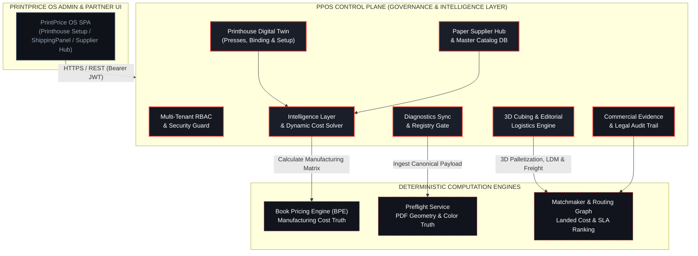

# Control Plane (`ppos-control-plane`)

The **Control Plane** is the central operational cockpit, intelligence layer, and multi-tenant commercial governance hub of **PrintPrice OS**.

---

## 1. System Mission & Architectural Role

PrintPrice OS is architected on a strict platform decoupling model:

> **Engine produces truth. Service preserves truth. Worker executes truth. BFF displays truth. Control Plane governs truth, tenants, and commercial operations.**

While specialized microservices (such as the Preflight Engine and Book Pricing Engine) perform heavy deterministic computational tasks, the **Control Plane** acts as the authoritative orchestration and management layer. It coordinates multi-tenant isolation, digital twin machine configurations, paper supplier ecosystems, and the commercial audit trail.



---

## 2. Core Subsystems

### A. Multi-Tenant Governance & Role-Based Access Control (RBAC)
- **Tenant Isolation**: Every organization, printhouse, and supplier operates inside a strictly isolated tenant context. Cross-tenant leakage is prevented by database query constraints and middleware session verification.
- **Granular Roles**: Role-based permissions govern actions across `Superadmin`, `Tenant Admin`, `Estimator`, `Production Manager`, and `Supplier Partner`.
- **Token Decoupling**: Administrative tokens (`PPOS_CONTROL_TOKEN`) are never leaked to edge workers or upstream clients; services communicate via isolated, purpose-scoped tokens.

### B. Intelligence Layer & Dynamic Cost Solver
- **Dynamic Imposition & Calculation**: Connects print specifications directly with the Book Pricing Engine (BPE) to evaluate sheet yields, signatures, waste allowances, and press speeds.
- **Margin Multipliers & Overheads**: Allows tenants to configure margin rules, customer tier discounts, and overhead recovery factors without tampering with raw manufacturing base costs.
- **Separation of Concerns**: Enforces strict mathematical and reporting separation between **manufacturing economics** and **freight/logistics costs**.

### C. Paper Supplier Hub & Master Catalog Federation
- **Federated Master Database**: Centrally manages paper types, finishes, grammages, standard sheet dimensions, and certified eco-labels (`materials_catalog` and `paper_suppliers`).
- **Multilingual Self-Service Onboarding**: Provides a publicly accessible onboarding portal (`/supplier/register`) in English, Spanish, and German with real-time tax/VAT validation and normalized country directories.
- **Printhouse Substrate Linking**: Printhouses select substrates using the dynamic `<SupplierSelect>` combobox and `<CountrySelect>`, automatically bridging local inventory to global supplier catalogs.

### D. Printhouse Digital Twin Setup
- **Machine & Technology Profiles**: Configures sheetfed offset presses, digital toner devices, high-speed inkjet webs, and large-format machines.
- **Finishing & Binding Capabilities**: Detailed parameterization of saddle stitch lines, PUR/hotmelt perfect binding, case binding (tapa dura), wire-o, folding schemas, laminations, and foil stamping.
- **Operational Realities**: Encodes minimum/maximum sheet formats, hourly labor rates, makeready setup times, and run-speed waste curves.

### E. Commercial Evidence Trail & Legal Auditability
- **Traceability Invariant**: Every quote generated is tied to an immutable `evidenceId` and `selectedVariantId`.
- **Server-Side Authority**: All pricing calculations, matrix resolutions, and discounts are computed strictly server-side. The client application renders truth but never calculates pricing independently.

### F. Technical Diagnostics & Preflight Synchronization
- **Diagnostic Preservation**: Safely ingests and stores the deep `canonicalPayload` from the Preflight Service without altering or truncating engineering findings.
- **Status Lifecycles**: Translates preflight status flags (`SUCCESS`, `PARTIAL`, `DEGRADED`, `FAILED_RUNTIME_ENVIRONMENT`) into actionable production workflows.

### G. 3D Cubing, Editorial Logistics & Freight Matrix Engine
- **Deterministic 3D Palletization (`packagingAndCubingEngine.js`)**: Computes net trimmed book weight (including hardcover greyboard at `1.20 g/cm³` and endpapers), selects ergonomic FEFCO 0201 cartons (`≤ 15 kg`), and tiles cartons in interlocked pinwheel layers onto standard `1200 × 800 mm` EPAL Euro-pallets.
- **Editorial Warehouse Compliance (`warehouse_delivery_profiles`)**: Enforces receiving dock standards for major European book distributors (`ZEITFRACHT_ERFURT`, `ARVATO_VVA_GUETERSLOH`, `AMAZON_EU_FBA_STD`, `STANDARD_COMMERCIAL_DOCK`), including perimeter overhang setbacks, maximum pallet heights, and 48h slot-booking governance.
- **Landed Freight & Stackability (`logisticsDatabaseService.js`)**: Resolves taxable pallet weight under non-stackable LDM (`0.4 LDM = 740 kg`), double-deck carrier trucks, and printshop auto-stacking (`≤ 1200 mm`), while preserving strict accounting separation between manufacturing, packaging consumables, and carrier freight. See the [3D Cubing & Editorial Logistics Engine](/docs/engines/logistics-cubing-engine) and [Logistics & Freight REST API](/docs/api/logistics-api).

---

## 3. Public API Surface & Contracts

The Control Plane exposes structured REST endpoints for tenant management, paper catalog synchronization, and system observability:

### Substrate & Supplier APIs

#### `GET /api/admin/materials/suppliers`
Returns the active, federated list of verified paper manufacturers and distributors, combining registered suppliers, catalog historical vendors, and system baselines.
- **Headers**: `Authorization: Bearer <session_token>`
- **Response**:
```json
{
  "ok": true,
  "suppliers": [
    {
      "id": "sup_fedrigoni",
      "name": "Fedrigoni",
      "country": "IT",
      "currency": "EUR",
      "type": "registered"
    },
    {
      "id": "sup_torraspapel",
      "name": "Torraspapel (Lecta)",
      "country": "ES",
      "currency": "EUR",
      "type": "registered"
    }
  ]
}
```

#### `GET /api/admin/materials/catalog`
Searches the master substrate catalog by category, grammage, surface finish, and supplier.
- **Parameters**: `category` (e.g. `coated`, `uncoated`), `grammage_min`, `grammage_max`, `supplier_id`.
- **Response**: Array of normalized paper substrates including dimensional boundaries and base sheet pricing.

### Public Supplier Onboarding

#### `POST /api/supplier/register`
Self-service onboarding endpoint for paper manufacturers and distributors.
- **Access**: Public / Partner
- **Payload**:
```json
{
  "companyName": "Paper Distribution Corp",
  "brandName": "PaperCorp",
  "taxId": "ESA12345678",
  "country": "ES",
  "contactEmail": "partners@papercorp.com",
  "contactPhone": "+34912345678",
  "categories": ["coated", "uncoated", "offset"],
  "coverage": "national",
  "locale": "es"
}
```
- **Validation**: Enforces tax ID format compliance, duplicate prevention, and automated welcome email dispatch.

### Observability & System Status

#### `GET /api/health`
Health and readiness probe for container orchestrators, uptime trackers, and load balancers.
- **Response**:
```json
{
  "status": "healthy",
  "uptime": 128450,
  "service": "ppos-control-plane",
  "version": "1.9.5",
  "database": "connected",
  "timestamp": "2026-10-24T00:00:00.000Z"
}
```

---

## 4. Architectural Invariants (Non-Negotiables)

Any contribution or modification to the Control Plane must strictly uphold the following five project invariants:

| # | Invariant | Enforcement Mechanism |
|---|---|---|
| **1** | **Server-Side Pricing Authority** | Prices, imposition calculations, and cost matrices are calculated exclusively by the backend. The frontend never computes prices locally. |
| **2** | **Strict Tenant Isolation** | Cross-tenant data leakage is strictly blocked. Every query and mutation is filtered through authenticated tenant session contexts. |
| **3** | **Commercial Auditability** | `evidenceId` and `selectedVariantId` must remain attached throughout the entire quoting and ordering lifecycle to guarantee legal certainty. |
| **4** | **Diagnostic Truth Preservation** | The Control Plane never alters, fabricates, or strips findings from the engine `canonicalPayload`. |
| **5** | **Strict Multilingual Parity** | All customer- and partner-facing interfaces must maintain simultaneous support for English (`en`), Spanish (`es`), and German (`de`) with zero text truncation. |

---

## 5. Technology Stack & Deployment

- **Runtime & Backend**: Node.js (v20+ LTS), Express REST architecture, PostgreSQL relational schema with JSONB metadata fields.
- **Frontend & Admin UI**: React 19, TypeScript, Vite, Tailwind CSS v4, custom Control Plane Design System (`#dc0000` primary accent, `Manrope` typography, `JetBrains Mono` telemetry).
- **Process Orchestration**: PM2 daemon management, Plesk hosting environment, Nginx reverse proxy with TLS/SSL termination.
