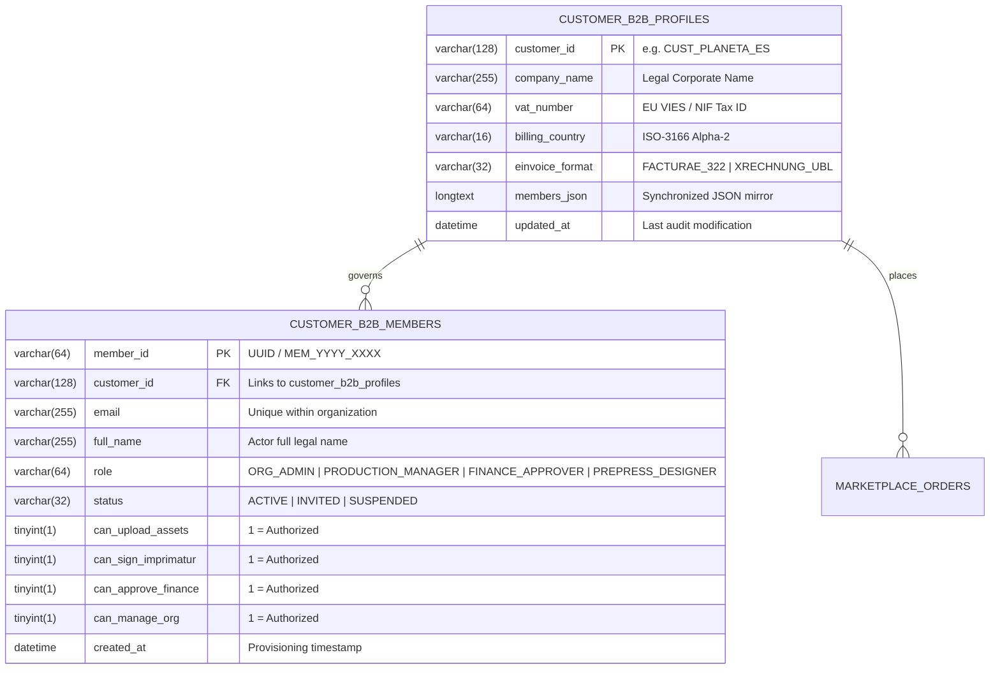
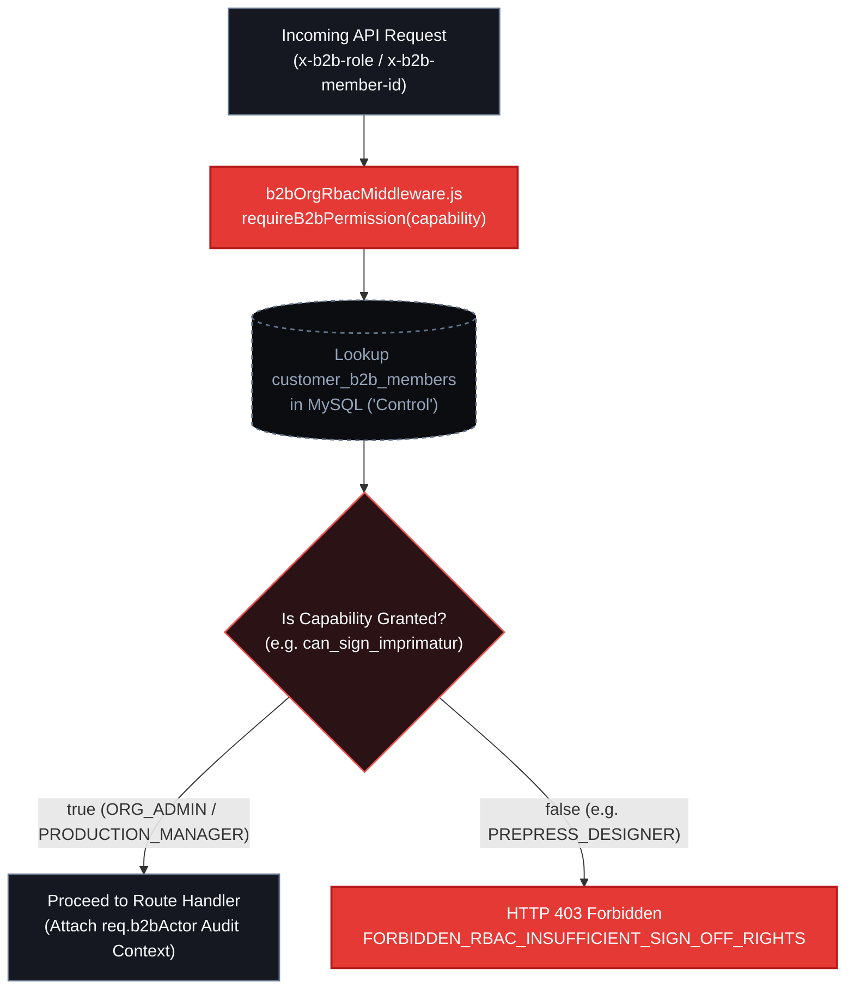

# B2B Multi-User Organization & Editorial RBAC Matrix

Enterprise publishing houses segregate operational duties across prepress designers, production directors, financial controllers, and corporate administrators. PrintPriceOS implements a strict **Multi-User B2B Role-Based Access Control (RBAC)** governance model enforced at the API middleware layer (`b2bOrgRbacMiddleware.js`) and reflected dynamically in the Publisher Hub UI (`budget.printprice.pro`).

---

## 1. Normalized Relational Schema (`MySQL`)

Multi-user B2B governance extends the corporate fiscal entity (`customer_b2b_profiles`) with a normalized membership table (`customer_b2b_members`) while maintaining backward compatibility via synchronized `members_json` snapshots.

### 1.1 Entity-Relationship Diagram



---

## 2. The Four Canonical Editorial Roles & Permissions Matrix

PrintPriceOS defines four canonical roles tailored to industrial publishing workflows. Every member record stores both the canonical `role` identifier and explicit boolean capability flags (`can_*`) evaluated at runtime:

| Capability / Protected Action | `ORG_ADMIN` (Corporate Admin) | `PRODUCTION_MANAGER` (Production Director) | `FINANCE_APPROVER` (Controller / CFO) | `PREPRESS_DESIGNER` (Prepress / Studio) |
| :--- | :---: | :---: | :---: | :---: |
| **Upload `INTERIOR_PDF` & `COVER_PDF` Assets** (`can_upload_assets`) | **YES** | **YES** | NO (`403`) | **YES** |
| **Inspect 6-Axis Preflight Telemetry & 3D Mesh** | **YES** | **YES** | **YES** *(Read-Only)* | **YES** *(Inspect Only)* |
| **Sign 3D Soft-Proof Imprimatur & Lock Escrow** (`can_sign_imprimatur`) | **YES** | **YES** | NO (`403`) | NO (`403`) |
| **Trigger 1-Click Reorders** (`can_sign_imprimatur`) | **YES** | **YES** | NO (`403`) | NO (`403`) |
| **Execute Checkout, Upload Wire Proof & Download EN 16931 XML** (`can_approve_finance`) | **YES** | NO (`403`) | **YES** | NO (`403`) |
| **Invite, Mutate Roles, or Revoke Organization Members** (`can_manage_org`) | **YES** | NO (`403`) | NO (`403`) | NO (`403`) |

---

## 3. Middleware Enforcement Mechanics (`b2bOrgRbacMiddleware.js`)

All sensitive endpoints in [`src/api/routes/marketplaceOrders.js`](/docs/api/reference) and [`src/api/routes/customerPortalRoutes.js`](/docs/api/reference) are guarded by `requireB2bPermission(capability)` in `src/api/middleware/b2bOrgRbacMiddleware.js`.

### 3.1 Actor Resolution Precedence

When a request arrives at the Control Plane, the middleware resolves the caller's effective RBAC profile in the following order:

1. **Database Member Lookup (`x-b2b-member-id` / `x-b2b-email` + `customer_id`):**
   - Queries `customer_b2b_members` for an `ACTIVE` member matching the organization. If the member is `SUSPENDED`, execution halts immediately with `403 FORBIDDEN_RBAC_MEMBER_SUSPENDED`.
2. **Explicit Role Header / Payload Resolution (`x-b2b-role` / `approved_by_role`):**
   - Evaluates the canonical role matrix (`ORG_ADMIN`, `PRODUCTION_MANAGER`, `FINANCE_APPROVER`, `PREPRESS_DESIGNER`) passed via BFF headers or request body.



### 3.2 Canonical HTTP `403 Forbidden` Error Catalog

When an actor attempts an action outside their role's capability matrix, the API returns a deterministic `403 Forbidden` JSON contract:

| Protected Capability | Guarded Canonical Endpoints | HTTP Status | Error Code (`error` / `code`) |
| :--- | :--- | :--- | :--- |
| `canApproveSoftProof` (`requireSignOffRights`) | `POST /api/customer/orders/:orderId/soft-proof/approve`<br/>`POST /api/customer/orders/:orderId/reorder` | `403 Forbidden` | `FORBIDDEN_RBAC_INSUFFICIENT_SIGN_OFF_RIGHTS` |
| `canExecutePayments` (`requireFinanceRights`) | `POST /api/marketplace/orders/:orderId/checkout/session`<br/>`POST /api/marketplace/orders/:orderId/payment/wire-proof`<br/>`GET /api/financials/escrow/:orderId/e-invoice.xml` | `403 Forbidden` | `FORBIDDEN_RBAC_FINANCE_RIGHTS_REQUIRED` |
| `canUploadProductionFiles` (`requireAssetUploadRights`) | `POST /api/marketplace/orders/:orderId/files/upload`<br/>`POST /api/marketplace/orders/:orderId/files/external-link` | `403 Forbidden` | `FORBIDDEN_RBAC_ASSET_UPLOAD_RIGHTS_REQUIRED` |
| `canManageMembers` (`requireOrgAdminRights`) | `POST /api/customer/organization/members`<br/>`PUT /api/customer/organization/members/:memberId/role`<br/>`DELETE /api/customer/organization/members/:memberId` | `403 Forbidden` | `FORBIDDEN_RBAC_ORG_ADMIN_REQUIRED` |

#### Sample `403 Forbidden` Response Payload

```json
{
  "ok": false,
  "error": "FORBIDDEN_RBAC_INSUFFICIENT_SIGN_OFF_RIGHTS",
  "code": "FORBIDDEN_RBAC_INSUFFICIENT_SIGN_OFF_RIGHTS",
  "message": "Binding 3D Soft-Proof Sign-Off and CTP release require PRODUCTION_MANAGER or ORG_ADMIN role. Active role 'PREPRESS_DESIGNER' is not in [ORG_ADMIN, PRODUCTION_MANAGER].",
  "actorRole": "PREPRESS_DESIGNER",
  "requiredRoles": ["ORG_ADMIN", "PRODUCTION_MANAGER"]
}
```

---

## 4. Organization Member Management API Examples

### 4.1 List Organization Members & Capabilities

```bash
curl -X GET "https://control.printprice.pro/api/customer/organization/members" \
  -H "x-marketplace-token: YOUR_MARKETPLACE_TOKEN" \
  -H "Accept: application/json"
```

### 4.2 Provision a New Member (`ORG_ADMIN` Required)

```bash
curl -X POST "https://control.printprice.pro/api/customer/organization/members" \
  -H "Content-Type: application/json" \
  -H "x-marketplace-token: YOUR_MARKETPLACE_TOKEN" \
  -H "x-b2b-role: ORG_ADMIN" \
  -H "x-b2b-member-id: MEM_2026_0001" \
  -d '{
    "fullName": "Lucia Fernandez",
    "email": "lucia.fernandez@planeta.es",
    "role": "PREPRESS_DESIGNER",
    "status": "ACTIVE"
  }'
```

#### Response (`201 Created`)

```json
{
  "status": "ok",
  "customer_id": "CUST_PLANETA_ES",
  "member": {
    "member_id": "MEM_2026_8912",
    "customer_id": "CUST_PLANETA_ES",
    "full_name": "Lucia Fernandez",
    "email": "lucia.fernandez@planeta.es",
    "role": "PREPRESS_DESIGNER",
    "status": "ACTIVE",
    "can_upload_assets": true,
    "can_sign_imprimatur": false,
    "can_approve_finance": false,
    "can_manage_org": false
  }
}
```

